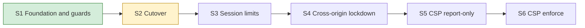
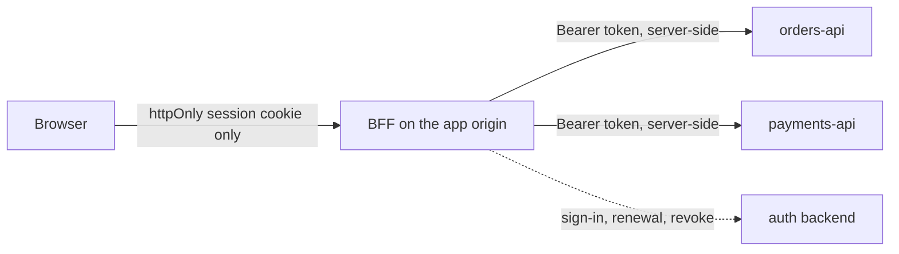
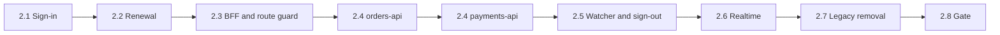

# Report & Plan Formats

Both files live in `.hbtl/frontend-security/` in the target app. Ask before adding `.hbtl/` to `.gitignore`.

## audit.md

```markdown
# Frontend Security Audit — {app}

Date: {YYYY-MM-DD} · Stack: {Next 16.x App Router + Auth.js 5.x | Nuxt 4.x} · Runtime: {standalone | serverless | static ⚠} · Adapter: {nextjs-authjs | nuxt-auth-utils | other: …}

## Facts sheet
- Current auth lifecycle: {narrative}
- Backends: {table from detection}
- Realtime: {…} · Rendering: {…} · Existing store: {none | Redis via REDIS_URL}
- Backend refresh policy: {rotation? reuse detection? revoke endpoint? access-token lifetime} ({source: code | user | assumed})
- Token sizes: access {n} B, refresh {n} B → estimated session cookie {n} B · Prod proxy/CDN: {name, header limit if known}
- Server entry points: {table: path · method(s) · kind · current check · intended access · returns or changes · no-cookie status}
- Secrets: {table: file:line · kind · fingerprint (first 4 chars + length) · in history? · likely live?}. Never the value.

## Invariant status
| Invariant | Status | Findings | Residual |
|-----------|--------|----------|----------|
| INV-1 Credential isolation | violated | R-01, R-02 | — |
| … | met / violated / met with residual / blocked | | {window, accepted by, date} |

## Findings
### {R-xx} {title} — {Severity}
- **Violates:** INV-n
- **Where:** `path/file.ts:42` (+ N more)
- **Evidence:** `localStorage.setItem("token", res.data.accessToken)`
- **Impact:** {one concrete sentence}
- **Closed in:** S2
- **Status:** open | fixed | blocked ({owner/why}) | accepted ({by, date})

## Out-of-scope observations
- {XSS sinks, non-auth open redirects, dependency risk: file:line. Listed for follow-up only.}
```

Rules: one finding per rule per root cause, with repeated locations grouped. Evidence never includes real
tokens, secrets, or env values: redact them. Order findings by severity, then rule ID.

## plan.md

````markdown
# Frontend Security Plan — {app}

Approved: {stages + date, as the user said it}
Branch: users/{username}/feature/{short-desc} (created | existing) · PR target (suggested): {integration branch}

## Diagrams
Stage flow (only the remaining stages; set `class <current> current`):


Target architecture (one node per detected backend, named as in the facts sheet):


S2 checkpoints (2.4 expands to one node per backend):

Use plain-text labels: no `"`, `(`, `)`, `{`, or `}` inside `[...]` unless the label is quoted.

## Decisions
| ID | Choice | Inputs | Source |
|----|--------|--------|--------|
| D1 | Cookie | refresh tokens reusable (no reuse detection); revoke endpoint exists; access token 10 min → residual ≤ 10 min | user, 2026-11-16 |
| D3 | Atomic | 2 HTTP clients | detection |
| … | | | |

## Component map
{adapter table, filled for this app}

## Assumptions
- {assumption} (confirmed | default)

## Stages
| Stage | Closes | Status |
|-------|--------|--------|
| S1 | INV-8 | done |
| S2 | INV-1,2,3,4,5,7,11,12 | in-progress |

### S2 Cutover
**Files:** … · **New deps:** pkg@ver (audit result) · **Commit:** {short SHA}
**Hard checks:** {list + result}
**V-tests:** V-1 ✓ · V-2 ✓ · V-7 ✓ (residual measured: 9m40s) …
**Mechanical:** typecheck ✓ · lint ✓ · build ✓ · tests ✓ (n) · snyk: {result}
**Impact map:** {table}
**Flows for the user:** {checklist}
**User result:** {pass / issues}
**Follow-ups:** {backend team items}
````

Valid statuses: `pending`, `approved`, `in-progress`, `done`, `blocked`, `skipped`.
