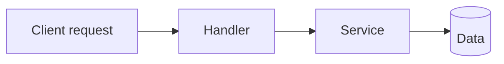

# {{FEATURE_NAME}} ({{FEAT_ID}})

_Phase 2 sub-plan produced by the planning subagent after Phase 1's overall plan was approved. Complements the Azure task specs (which carry per-task acceptance criteria) with the architectural and testing detail needed to implement the feature well. See the overall plan for context._

## Overview

One-paragraph summary: what the feature delivers, why it matters, who uses it.

## Acceptance criteria

**Required.** Feature-level "done when" checklist — **observable outcomes** a human could check by using the feature. Complements the per-task acceptance woven into each Azure task description (task-level there, feature-level here); never a copy of that HTML.

- Submitting the form with an empty phone field is rejected with an inline error; nothing is saved.
- A saved contact appears in the list without a page reload.
- Opening the list with no contacts shows the empty state, not a spinner.

<!-- Not acceptance criteria — these restate the implementation, not the outcome:
     ✗ "Add a `validatePhone` helper in `utils/validation.ts`"
     ✗ "Wire the POST handler to the service layer"
     Those belong in Files to touch / Task summary. -->

## Flow diagram

Feature-scoped flow — routes/handlers/functions the request/data flows through inside this feature.

## Files to touch

| File | What changes | Connections |
|---|---|---|
| `src/…/Foo.cs` | Adds endpoint `POST /api/foo` | Called from `Bar.cs`; writes `FooTable` |
| `src/…/BarConsumer.cs` | Publishes new event `FooCreated` | Consumed by … |

For each file, describe the change in code terms, not English. When GitNexus is available, populate `Connections` with real edges (calls, imports, DB tables, Kafka topics) — otherwise infer from imports.

## Detailed component/module map

For each file above:

- **Exports/entry points changed** — function signatures added or altered, new classes, new endpoints.
- **Function signatures added** — parameters, return types.
- **DB tables or Kafka topics touched** — schema changes, new topics/consumers.
- **Config keys read** — new appsettings/env-var keys.

## Data flow

Inputs → transformations → outputs at the function/route level. Where does data enter? What functions transform it? Where does it leave (response body, event bus, storage)?

## Test plan

Enumerate the specific test cases per `requiredTests` layer. This is the checklist the task's `verification` command must satisfy.

- **unit** — <case 1>, <case 2>, …
- **integration** — <case 1>, <case 2>, …
- **e2e** (frontend UI) — <flow 1>, <flow 2>, … (Playwright)
- **karate** (backend services) — <business flow 1>, <business flow 2>, … (see Hubtel dev-docs `pipelines-karate-test` — fetch via engineering MCP `get_doc` before authoring feature files)

## Interface contracts

- **Request/response shapes** — new endpoint payloads (JSON schema or code excerpt).
- **Event schemas** — new/changed Kafka events.
- **Storage schemas** — new tables, columns, indexes.

## Task summary

One line per task, written as an actionable deliverable — what a human will see land when this task is done. Read like a sentence, not a slug: no robotic phrases (avoid "Implement X module", "Add Y component", "Wire up Z"). The full implementation contract (Target File / Summary / Implementation Guidelines / Code Sample / Reference) lives on the Azure task, created via `harness_create_tasks` after the breakdown is approved.

- **task-NNN** — Parse and validate commit subjects, body ≤ 300 chars, and `Closed: #id` trailers against the allowed Conventional types.
- **task-NNN** — Surface touched services at commit approval so backend engineers see the exact `build:` suffix that will land in the subject.

## Sequencing within the feature

Order tasks with explicit "why this depends on that" notes — not just `dependencies: []` in `feature_list.json`.

1. **task-NNN** — must run first because …
2. **task-NNN** — depends on task-NNN's schema being in place …

## Dependencies

- External dependencies added to `package.json` / `.csproj` — must be audited via `audit_packages` before install.
- Cross-feature dependencies (rare — usually captured in the overall plan).

## Risks

- Failure modes, migration risks, rollback strategy, backwards-compatibility notes.
