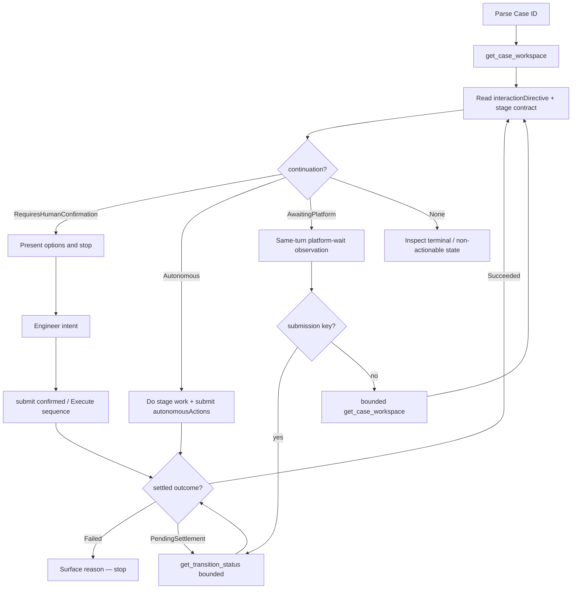

# Loop Capability Operation

Loop owns Case state, stage contracts, and allowed transitions. The agent investigates and submits **semantic actions** — it never mutates workflow state directly.

**Prerequisite:** `loop-engineering` MCP must be connected. DeviceCredential-gated Case APIs go through the **Hubtel Loop Agent** desktop app, which publishes `~/.loop-engineering/loop-local-ops.sockpath`. MCP rediscovers that file on every tool call — engineers do **not** need the LoopEngineering or UI git workspaces. Start (or restart) the Agent if MCP returns 401. DeviceCredential never lives in MCP config.

## Interaction directive (authoritative continuation)

Workspace and settled submit responses include **`interactionDirective`** — a **projection** from capability contracts (not a second persisted interaction state machine):

| Field | Meaning |
|-------|---------|
| `phase` | Engineer-facing phase (Assignment, Investigation, AwaitingHumanInput, AwaitingPlanningAuthorization, Planning, PlanReview, AwaitingExecutionAuthorization, Execution, Decision, Review, Platform, Terminal) |
| `continuation` | `Autonomous` \| `RequiresHumanConfirmation` \| `AwaitingPlatform` \| `None` |
| `requiresHarness` | Planning/Execution must ensure/resume the Engineering Harness in the target repo |
| `permittedActions` | All actions valid now |
| `autonomousActions` | RHC=false actions Cursor may submit without a new human confirm |
| `humanConfirmationActions` | Actions that require explicit engineer intent |
| `stopReason` | Why Cursor must stop when `continuation` is `RequiresHumanConfirmation` |
| `humanInputRequest` | When phase is `AwaitingHumanInput`: outstanding question (`question`, `requestedAtUtc`, `requestedFromStage`) from durable `RequestHumanInput` — present this exact question after restart; null when not awaiting input |

**Rules:**

1. **First-touch** — When the engineer pastes a Case ID / "Work on Loop CASE-…": call **`get_case_workspace` first**, then **trust `interactionDirective`** (see **First-touch continuation** below). Pasting a Case ID is not consent to cross `RequiresHumanConfirmation` / RHC=true actions.
2. **Engineer-facing replies** — Consume `interactionDirective` for continuation control only. **Do not echo** Directive / phase / continuation / requiresHarness / stopReason / permittedActions machinery into chat. Speak in plain English about the Case, what was found, and the choices — see **Plain-English replies** below.
3. **`RequiresHumanConfirmation`** — Authoritative stop. Present options (`humanConfirmationActions` / `availableActions`), wait for explicit engineer intent. Do **not** submit. Honor `stopReason` internally (do not dump the field name/value unless it helps the engineer decide).
4. **`Autonomous`** — Cursor **may** perform stage work and submit **`autonomousActions`** in the **same turn** (including first-touch when Loop projected Autonomous), chaining from each **settled** response until `continuation` becomes `RequiresHumanConfirmation` or terminal `None`. **`AwaitingPlatform` is not a turn-ending stop** — follow **Platform-wait continuation** below, then resume from the authoritative directive. Stop on exceptions. Never submit RHC=true / `humanConfirmationActions` without explicit engineer intent (except the approved Execute→ApprovePlan+ApproveExecution sequence).
5. **Execute intent exception** — One explicit engineer intent such as **"Execute this plan"** may drive **two sequential durable actions** when both are valid: `ApprovePlan` → settle → `ApproveExecution` → settle → Execution. Do **not** merge backend semantics. Fail closed if either action is invalid or settlement fails. Never infer the second authorization from an unrelated earlier utterance.
6. **Gate B** — After successful local implementation/validation, **stop**. Present the diff and ask the engineer to review. Submit `ApproveImplementation` only after **explicit chat confirmation** (it is RHC=true / in `humanConfirmationActions`). Then commit/push, then `CompleteExecution`. Cursor tool **Run / Always Run is not implementation review** — do not call the MCP or `git push` until the engineer confirms in chat. Stop without asking only on failed validation, material plan deviation, or safety conditions.
7. **Loop wins over Harness** — Loop authorization always overrides Harness `approvalMode` / autopilot. Do not let harness autopilot bypass Loop gates.
8. **PendingSettlement** — Observational only via **`get_transition_status`** (keyed by `submissionId` / `idempotencyKey`). Never re-signal; never invent a background poller. After **AcceptAssignment**, settlement often stays **PendingSettlement** until the first Cursor-actionable investigation stage (Pipeline `InvestigationPlanning` / PI `InvestigationBrief`) — then Succeeded with Autonomous continuation. **Stay in the same agent turn** and observe until Succeeded / Failed / budget exhaustion (see **Platform-wait continuation**).
9. **`AwaitingPlatform`** — Platform-owned work is still progressing (empty Cursor actions). This is a **wait-and-resume** state, **not** a human gate and **not** a reason to end the turn. Do **not** invent actions; do **not** ask the engineer to refresh or type "continue"; do **not** claim you will resume later unless an automatic resume mechanism actually exists in this session. Observe in the same turn (see **Platform-wait continuation**), then continue when the directive becomes Autonomous or stop at a genuine RHC / terminal / budget limit.
10. **`None`** — Inspect the actual Case/capability state. Often terminal / no further Cursor progression — present status and do not invent actions. Do **not** blindly assume success; if the Case is not terminal but actions are empty, report the factual state.

### Plain-English replies

The engineer reading the chat cares about the Case — what went wrong, what you found, and what they can decide. Write for them, not for the platform.

- **Say what it means, not how it works.** "I couldn't send your decision to Loop" — not "POST `/capabilities/{id}/actions` returned HTTP 401". "The Loop Agent isn't reachable" — not socket paths, sockpath files, or process lists.
- **Never surface internals:** HTTP status codes, API routes, DeviceCredential / tokens / auth headers, socket or file paths, environment variables, process IDs, MCP tool names, raw JSON, stack traces, or shell/tool output. Use stage objectives and action `displayLabel`s, not durable stage enums or `actionName`s.
- **Failures follow the same rule.** Investigate quietly; then report in one or two sentences: what is blocked, whether the engineer's work is safe, and the one thing they can do (e.g. "Open the Hubtel Loop Agent app, then say continue"). Do not narrate the diagnosis step by step or paste what you ran.
- Keep updates short. Technical detail belongs to the Case content itself (root cause, affected files, proposed changes), where the engineer needs it to decide.
- **Do not invent a second label dictionary** in this skill. Always take option text from `currentStageContract.availableActions[].displayLabel` (fallback to `actionName` only when `displayLabel` is missing).

### First-touch continuation (authoritative)

On first touch always:

1. Call **`get_case_workspace`**.
2. Trust the returned **`interactionDirective`**.
3. If **`continuation` = `RequiresHumanConfirmation`**: present decision/context (first-touch summary + options); **STOP**; do not submit without human intent.
4. If **`continuation` = `Autonomous`**: Cursor **MAY** continue the authorized autonomous phase **in the same turn** — perform permitted work, submit RHC=false / `autonomousActions`, follow settled autonomous continuation; **stop** only at the next genuine human boundary (RHC), terminal `None`, error, or observation-budget exhaustion. Do **not** invent a "continue" / "submit review" human message. Do **not** treat temporary `AwaitingPlatform` as that boundary — observe and resume (see **Platform-wait continuation**).
5. If **`continuation` = `AwaitingPlatform`**: observe in the **same turn** per **Platform-wait continuation**; do **not** end the turn with "I'll continue when Loop advances" / "No action needed from you right now" unless the observation budget is exhausted or settlement failed. After the Case becomes actionable, continue Autonomous work without requiring another engineer message.
6. If terminal (`None` / Terminal phase): present the factual result/status; do not invent actions.

First-touch protects against **unauthorized** mutation (RHC=true). It must **not** invent a human gate when Loop already projected **Autonomous**.

## Hard gate (violations invalidate the prototype)

1. First-touch: always **`get_case_workspace` first**, then follow **First-touch continuation** from `interactionDirective` — never invent actions outside that directive.
2. Never submit a `humanConfirmationActions` / RHC=true action without explicit engineer intent (except the approved Execute→ApprovePlan+ApproveExecution sequence after one Execute intent).
3. After workspace load / settled responses, drive all continuation from **`interactionDirective`** + settled context — not chat history.
4. Never skip Fail-closed settlement checks.
5. **`close_engineering_case`** — requires explicit confirmation (reason + outcomeType); never infer from Case open alone.

## Standard operating model

1. **Get Case workspace** — `get_case_workspace` (first-touch or resume).
2. **Read `interactionDirective` + stage contract** — phase, continuation, harness need, actions.
3. **If RHC** — summarize, present options, **stop**.
4. **If Autonomous** — perform only the current stage objective; build durable outputs; submit autonomous actions; continue from settled `interactionDirective`.
4b. **If AwaitingPlatform or PendingSettlement** — observe in the same turn (**Platform-wait continuation**); do not invent actions; do not end the turn merely because platform work is temporary.
5. **Keep conversational work in Cursor** — Loop persists only submitted artifacts.
6. **Consume settled context** — `outcome` / `currentStage` / `availableActions` / `interactionDirective`. After **Succeeded**, prefer that settled directive — do **not** call `get_case_workspace` as normal UX. Exception: when observing `AwaitingPlatform` **without** a pending submission key, bounded re-`get_case_workspace` is the allowed observation mechanism (not a post-success refresh).
7. **Observational PendingSettlement** — when a `submissionId` / `idempotencyKey` exists, use `get_transition_status` only (never re-submit).

## Operating rules

1. When given a Loop Case ID, call `get_case_workspace`.
2. Read `capability.currentStage`, `capability.expectedStage`, `currentStageContract`, and **`interactionDirective`** before acting.
3. **Stop when `continuation` is `RequiresHumanConfirmation`** — summarize the objective in plain words and present options by `displayLabel`. Honor `stopReason` internally. When **two or more** actions apply, use **AskQuestion** when available (see **Structured option prompts**).
4. **Submit without a new confirm only for `autonomousActions`** when `continuation` is `Autonomous` (including first-touch when Loop projected Autonomous). Never submit RHC=true / `humanConfirmationActions` without explicit engineer intent (except approved Execute dual-chain).
5. If assignment offer is active (`phase` Assignment), only discuss **Accept** / **Decline** (from `displayLabel`; submit as `AcceptAssignment` / `RejectAssignment`) until the engineer chooses.
6. After Accept settles into Investigation (`continuation` Autonomous): run investigation and submit completion actions autonomously; then **stop** when planning authorization / HumanDecision / PlanReview is required. For **Pipeline**, stop at `AwaitingPlanningAuthorization` (**Fix review**) and offer Fix it (`ApproveFix`), Change plan (`RequestPlanRevision`), Plan in detail (`ApprovePlanning`) or No fix needed (`MarkNoRemediation`). For **PI**, after Plan* disposition proceed directly to Harness-backed RemediationPlanning (no second ApprovePlanning ask).
7. If the stage is `Recommendation`, formulate an evidence-backed disposition recommendation. Submit **CompleteRecommendation** when autonomous; never auto-select a human disposition.
8. If the stage is `AwaitingHumanDecision` / RA `HumanDecision`, present dispositions — never auto-select even when confidence is high. For PI, when `ApproveFix` (**Fix it**) is offered, show `humanDecision.activeRecommendation.proposedFixPlan` with it; it appears only when that plan is `complete`.
8b. If RA `ReleaseReview`, ownership is Accepted, and `continuation` is Autonomous: surface deployment + host evidence in plain words, then produce and submit **Finish review** (`CompleteReleaseReview`) without asking the engineer to authorize the submit; then stop at HumanDecision and present disposition options by `displayLabel` (Roll back / Accept risk / Re-collect evidence).
9. If `requiresHarness` is true (**Planning or Execution on a code-change capability** — Production Investigation, and Pipeline Remediation after Plan in detail; Pipeline Execution reached through Fix it projects `requiresHarness: false`, so implement directly without scaffolding a Harness): resolve the target repo; resume the Engineering Harness or invoke `hbtl-harness-creator` (skill command **scaffold** if missing). **Planning:** follow that skill (overall plan, breakdown, **engineer approval of the breakdown**, Azure/task rows) then submit Loop `CompletePlanning` / `CompleteRemediationPlan`. **Execution:** implement through the same harness, stop for chat review, then Gate B / push. Never use the legacy Worker coding harness. Reuse one harness for Planning and Execution unless evidence requires otherwise. Release Assurance has no code Planning/Execution and does not set `requiresHarness`.
10. Treat Loop evidence as production facts, not automatically as conclusions.
11. Use repository/internal tooling to satisfy the current stage objective.
12. Do not transition merely because work was attempted or a draft exists in chat.
13. Submit required stage output before completion actions that require outputs.
14. Only use actions from `currentStageContract.availableActions` / `interactionDirective.permittedActions`.
15. Honor `requiresHumanConfirmation` and `interactionDirective` — do not maintain a separate hard-coded confirmation list that contradicts the directive.
16. Use **`capability.expectedStage`** for submissions — never submit persisted workflow aliases such as `AwaitingPlanReview` or `HarnessExecution`.
17. If new evidence invalidates prior work, use a permitted backward transition.
18. Never invent Case state.
19. Never perform destructive actions outside governed Loop actions.
20. After settled success, continue from settled context. For `PendingSettlement`, observe with `get_transition_status` (never re-submit). For `AwaitingPlatform` without a submission key, use bounded `get_case_workspace` observation.
21. For execution stages, read `executionContext` — never reconstruct execution state from chat history.
22. Git commit/push is Cursor agent work — never invoke Loop MCP for Git operations. **Do not push until Gate B (`ApproveImplementation`) is recorded after explicit engineer review of the implementation.** Cursor Always Run is not that review. After authorization + Gate B, validate then push, then `CompleteExecution`.

## Platform-wait continuation (same-turn observation)

Temporary platform work is **not** a human gate. After an accepted assignment or any submitted capability action, **stay in the active agent turn**, observe until the Case is actionable again (or a real stop condition), then resume Autonomous work **without** requiring another engineer message.

### Distinguish waiting from stopping

| Signal | Meaning | Agent behaviour |
|--------|---------|-----------------|
| `AwaitingPlatform` | Platform-owned work in progress; no Cursor actions yet | **Observe and resume** in the same turn — not a stop |
| `outcome: PendingSettlement` | Submitted action has not finished settling | **Observe** with `get_transition_status` — never re-submit |
| `continuation: Autonomous` | Cursor may perform authorized stage work | **Continue** stage work / submit `autonomousActions` |
| `continuation: RequiresHumanConfirmation` | Genuine human decision / authorization gate | **Stop**; present options; wait for explicit engineer intent |
| `continuation: None` | Inspect actual Case/capability state | Report factual terminal or non-actionable state; do **not** invent success |

### Observation mechanism

1. After every submit, inspect the authoritative transition result (`outcome`, settled `interactionDirective` when present).
2. If **`PendingSettlement`** (or you hold a live `submissionId` / `idempotencyKey` from a just-submitted action): call **`get_transition_status`** with that key. Repeat while settlement is still pending. **Do not** resubmit the action merely because settlement is pending.
3. If **`AwaitingPlatform`** and **no** submission key exists (e.g. first-touch after Accept already recorded, platform still collecting): use **bounded `get_case_workspace`** reloads to observe progress. This is platform-wait observation — **not** the forbidden post-Succeeded refresh.
4. After settlement **Succeeded**, prefer the settled transition response's `interactionDirective` / stage contract. Avoid redundant `get_case_workspace` when that settled context is already sufficient.
5. If the settled (or refreshed) directive is **`Autonomous`**, continue authorized work immediately in the same turn.
6. Chain through subsequent Autonomous stages until a genuine RHC gate, terminal `None`, failure, or observation-budget exhaustion.
7. Use the **current** authoritative directive — do **not** assume a fixed next stage from the action you just submitted.

### Observation budget (defaults, not absolutes)

- Default ceiling: up to **12** observation calls **or** about **90 seconds** wall clock — **whichever limit is reached first**.
- Also stop early if the MCP/tool reports a timeout or hard execution limit.
- Prefer a modest interval between observations when the runtime supports waiting (e.g. brief shell `sleep` between calls). **Do not** invent a dedicated sleep/poller tool, background job, or Temporal workflow. **Do not** hammer the API with near-zero-interval retries.
- **Budget exhausted while still waiting:** report the **actual** Case state (plain English), say that **another invocation is required** to keep watching, and stop. Do **not** promise automatic resume outside this session.
- **Terminal settlement failure:** stop with an accurate failure explanation; do not re-submit the same intent without engineer direction.
- Distinguish **PendingSettlement** (still observing) from **Failed** (stop).

### Engineer-facing language while observing

Allowed (and then you **must** keep observing):

> Loop is finishing evidence collection. I'm checking for the next actionable stage.

**Forbidden** unless the observation budget is exhausted or there is a real automatic-resume mechanism in this session:

- "I'll pick up investigation as soon as Loop advances"
- "I'll continue when Loop advances"
- "No action needed from you right now" (when you are ending the turn while platform work is still temporary and the budget remains)

### Capability-specific human stops (unchanged)

After platform wait clears, continue Autonomous work until **that capability's** real human gate:

- **Pipeline Remediation** — stop at **Fix review** (`AwaitingPlanningAuthorization`); present Fix it / Change plan / Plan in detail / No fix needed. Do **not** auto-select.
- **Production Investigation** — continue Brief → Diagnosis → Recommendation; stop at **AwaitingHumanDecision** disposition. Do **not** import PF Fix review or an extra ApprovePlanning step; Plan in detail (`PlanCodeRemediation`) already authorizes planning under PI's contract.
- **Release Assurance** — may use this same observation protocol after Accept / PendingSettlement; **Finish review** and **HumanDecision** contracts remain unchanged (never auto-pick dispositions).

## Human confirmation

Explicit engineer confirmation is required before submitting any action in **`humanConfirmationActions`**, or whenever `continuation` is **`RequiresHumanConfirmation`**.

**Authoritative continuation rules** (do not invent a separate phase-authorization checklist):

- Trust **`interactionDirective`** — it controls whether Cursor may continue.
- **`Autonomous`** — may perform stage work and submit **`autonomousActions`** (RHC=false) without a new human confirm, including first-touch when Loop already projected Autonomous.
- **`RequiresHumanConfirmation`** — stop; require explicit engineer intent before any submit (except the approved Execute→ApprovePlan+ApproveExecution sequence).
- **`AwaitingPlatform` / `PendingSettlement`** — observe and resume in the same turn (**Platform-wait continuation**); do not invent actions; do not ask the engineer to refresh; do not end the turn merely because platform work is temporary.
- Never autonomously submit **`humanConfirmationActions`** / RHC=true actions.

### When a single path was proposed (N = 1)

Valid confirmations are clear directives such as:

- "accept" / "reject" (+ reason when required)
- "Fix it" / "Plan in detail" / "No fix needed" / "Change plan" (or the equivalent `displayLabel`)
- "proceed with planning" / "approve planning" / "Execute this plan" (maps to ApprovePlan then ApproveExecution when both valid)
- "yes, submit the plan" / "yes, complete investigation" / "approve the plan"
- a machine `actionName` when the engineer prefers it (e.g. `ApproveFix`, `PlanCodeRemediation`) — resolve to that `actionName` before submit

**Not sufficient on their own:** "looks good", "sounds fine", thumbs-up, or general enthusiasm without naming the option.

### Medium bar — when N ≥ 2 options were offered (structured option prompts)

After you presented **two or more** choices (AskQuestion picker or prose list of `availableActions` + Other), confirmation is **stricter**:

**Sufficient (any one):**

- An **AskQuestion** selection of one listed option (including **Other**, when Other text states a clear next intent)
- Naming the option by **`displayLabel` or `actionName`** (unambiguous), e.g. "Fix it", "Plan in detail", `ApproveFix`, `ApprovePlan`, "reject the assignment"
- **Other** free-text that clearly maps to one allowed path or an explicit non-submit intent (pause, refresh only, gather more evidence)

After a valid selection, **resolve to the authoritative `actionName`** from `currentStageContract.availableActions` before calling MCP. Engineers are **not** required to type PascalCase.

**Not sufficient when N ≥ 2 — do not submit:**

- Bare "yes" / "ok" / "go ahead" / "lgtm" / "looks good" / "sounds fine" / "do it" / emoji / silence
- Affirming the *recommendation* without naming which option ("that sounds right", "I agree with the recommendation")
- Selecting multiple actions in one message (except the approved Execute intent → ApprovePlan + ApproveExecution sequence)

**On insufficient reply:** do **not** call `submit_stage_output`, `request_capability_transition`, `submit_stage_retry`, or `close_engineering_case`. Re-present the **same** options (AskQuestion if available, else the same prose list) and ask the engineer to pick **one** named option or Other. One short re-ask — do not drip new questions.

## Structured option prompts

Whenever this skill applies and the engineer must choose among **two or more** paths, prefer the **AskQuestion** tool (selectable options + **Other**) when it is available in the current session's tool catalog.

**Confirmation level for this section:** use the **Medium bar** under **Human confirmation** — vague affirmatives never unblock a multi-option gate.

**Availability:** `AskQuestion` is **not** present in every Cursor session (some catalogs only expose tools such as `CreateGoal` / `GenerateImage` / `UpdateGoal`). Before calling it, confirm it exists in the live tool list. If it is missing or the call fails because the tool is unavailable:

- Fall back immediately to a **short prose question** with the same choices (compact bullets or a single sentence).
- Do **not** search the filesystem or MCP folders for AskQuestion.
- Do **not** treat missing AskQuestion as a blocker — the Medium confirmation bar still applies (named action or clear Other text required).

When AskQuestion **is** available, do **not** list options only as prose bullets or `A / B / C` text.

**Always include (picker or prose):**

- One selectable option per **primary** permitted action from `currentStageContract.availableActions` where `showInPrimaryOptions` is not `false` — use **`displayLabel`** as the AskQuestion / prose label (fall back to `actionName` only if `displayLabel` is missing). Keep `actionName` for submits only.
- **Mark the recommendation, don't filter by it.** When Loop (e.g. `humanDecision.activeRecommendation`) or established skill guidance favours one option, list it first with **(Recommended)** and a one-line reason; list the rest after it with a short plain-English note on what each does. Never invent a recommendation that contradicts `interactionDirective.permittedActions`.
- Do **not** list actions with `showInPrimaryOptions: false` (e.g. `RequestMoreInvestigation`) as primary picks — mention that path under **Other** when relevant (e.g. “want to dig further”).
- An option that needs extra input (e.g. a reason) is still listed — ask for the input after the engineer picks it.
- **Other** — free-text so the engineer can describe a different intent (e.g. dig further / re-investigate, partial plan revision, pause for evidence)

**Use AskQuestion (or prose fallback) at these Loop gates (non-exhaustive):**

| Moment | Options source |
| ------ | ---------------- |
| After first `get_case_workspace` when `continuation` is RHC | All `humanConfirmationActions` / `availableActions` + Other |
| `AwaitingPlanningAuthorization` (Pipeline **Fix review**) | Fix it / Change plan / Plan in detail / No fix needed (per contract `displayLabel`s) + Other |
| `AwaitingHumanDecision` | Disposition actions from contract + Other |
| `PlanReview` (when not covered by Execute intent) | Approve plan / Change plan / Cancel or No fix needed (per contract `displayLabel`s) + Other — **RejectPlan is not offered** |
| Presenting completed plan for execution | **"Execute this plan"** (ApprovePlan→ApproveExecution) / Change plan / Cancel + Other |
| `AwaitingExecutionApproval` alone | Start fix / Change plan / Cancel (per contract `displayLabel`s) + Other |
| Exceptional Execution stops (validation fail, deviation) | Gate B / Cancel / revise paths per contract + Other |
| After rejection or stage mismatch | Different action from settled contract / Other — **except** `Unauthorized`: do not offer retry of the same action with unchanged credentials; offer other permitted actions + Other |
| After `Unauthorized` rejection | Other permitted actions from authoritative contract (if any) + Other — never “retry same action” with the same identity |
| Stage-retry park (transient failure, post-delivery hold) | Retry / Replan via `submit_stage_retry` + Other — requires explicit confirmation; not a capability action |

Do **not** AskQuestion for normal Autonomous progress (investigation completion, planning completion after harness breakdown approval, CompleteExecution after a successful push and Gate B) when those actions are in `autonomousActions`. **Do** stop after local implementation for Gate B (`ApproveImplementation`) even when Execution continuation is Autonomous — that action is RHC.

### Stage retry (recovery, not capability actions)

When the workflow is **parked at a stage-retry gate** (status `AwaitingGuidance`, persisted stage such as `HarnessExecution`, `AwaitingExecutionApproval`, post-delivery parks), use MCP **`submit_stage_retry`** — not `submit_stage_output`.

- **`Retry`** — re-enter the park's primary stage (e.g. HarnessExecution → external execution attempt).
- **`Replan`** — jump to an earlier allowed target (Planning, Diagnosis, etc.) per park policy.
- Requires **explicit engineer confirmation** before calling (same bar as capability submits).
- After acceptance, continue from the **settled** response (`outcome` / `currentStage` / `availableActions`). Use `get_transition_status` only for `PendingSettlement`.

Mirror the summary in prose (first-touch template, gate explanations below). When AskQuestion is available, the **selection UI is the primary input**; when it is not, the prose ask is the gate.

Single-path updates with no real fork (e.g. "settled success — continuing at next stage") stay plain text — no AskQuestion.

When proposing **ApprovePlan** as part of **"Execute this plan"**:

> One intent freezes the plan (**ApprovePlan**) then authorizes repository modification (**ApproveExecution**). Both remain separate durable records.

When presenting Pipeline **Fix review** (`AwaitingPlanningAuthorization`), show the proposed fix from the brief (root cause, files, changes, validation) and explain the options:

> **Fix it** (`ApproveFix`) approves this brief as the plan and authorizes the change in one decision — two durable records, no Harness planning. **Change plan** (`RequestPlanRevision`, reason required) sends it back to investigation. **Plan in detail** (`ApprovePlanning`) opts into Harness scaffold/breakdown and full remediation planning. **No fix needed** (`MarkNoRemediation`) ends the Case.

`ApproveFix` is rejected up front when the Case has no PR ID — offer No fix needed with `UnsupportedNonPrFailure` instead. After `ApproveFix` settles at `Execution`, continue straight into implementation (Gate B still applies).

When **ApproveImplementation** (Gate B) is in `humanConfirmationActions` after local implementation:

> Implementation is done locally. Review the diff before freeze and push. Cursor **Run / Always Run** is not that review. Approving submits **ApproveImplementation**, then the agent may commit/push and **CompleteExecution**.

When proposing **CompleteExecution** after successful push and Gate B freeze, submit when it is in `autonomousActions` — do not ask for a redundant confirmation on the happy path.

## Standard workflow



### 1. Discover

When Teams notifies you of a pending assignment or investigation stage, paste the Case ID (or short id `CASE-XXXXXXXX`) into chat and start here:

```
get_case_workspace({ caseId: "CASE-3FA85F64" })
```

From the response, note:

- `case` — title, repository, service, severity
- `capability` — `executionId`, `currentStage`, **`expectedStage`**, `capabilityVersion`, `status`
- `currentStageContract` — `objective`, `instructions`, `requiredOutputArtifactTypes`, `availableActions`
- `evidence` — production and engineering evidence (facts to ground work)
- `previousStageOutputs` — prior brief/diagnosis (required context for planning)
- `humanDecision` — active recommendation and recorded disposition (e.g. `PlanCodeRemediation`)
- `reinvestigation` — populated after `RequestMoreInvestigation`
- `remediationPlanning` — when in planning/review: `session`, `latestPlan`, `priorPlans`, `review`, `revisionContext`
- `executionContext` — when at execution gates: `approval`, `approvedPlan`, `executionApproved`, `implementationApproved`, `phase`, `attempt`, `implementationReview`, `result`, `delivery`
- `pipelineRemediation` — Pipeline Cases: evidence, latest/approved EngineeringBrief, freeze/delivery flags, pipeline failure status
- `assignment` — assigned engineer when relevant

Use `get_case_evidence` or `get_available_actions` only when you need a focused slice without re-fetching everything. For Release Assurance **journal lines / host diagnostic detail**, use **`get_release_assurance_evidence`** (prefer `evidenceId` from `releaseAssurance.hostEvidence`) — workspace summaries like `journal: N line(s)` are not the full observation.

For Pipeline Remediation, prefer `pipelineRemediation.approvedEngineeringBrief` after ApprovePlan — never replace it with a newer mutable `latestEngineeringBrief` without revision/approval. Full reference: [references/pipeline-remediation.md](references/pipeline-remediation.md).

### 2. Work the stage objective

Align all work with `currentStageContract.objective` and `instructions`. Open the Case repository when code inspection is required.

Separate **observed facts** (from Loop evidence) from **hypotheses**. Cite evidence references in stage outputs.

**Diagnosis context during planning:** read `previousStageOutputs.latestDiagnosis` and evidence references. Do not duplicate diagnosis into the plan projection — reference it via `diagnosisReference` in the plan output.

**Human decision context:** read `humanDecision.recordedDisposition` (e.g. `PlanCodeRemediation`) to understand why remediation planning exists and what remediation type was selected.

### 3. Submit a governed action

Prefer `submit_stage_output`. The MCP resolves `expectedStage` from `capability.expectedStage` on the workspace; you supply the semantic action, optional `reason`, and required `output` fields.

**InvestigationBrief** (`CompleteInvestigation`):

```json
{
  "caseId": "CASE-3FA85F64",
  "action": "CompleteInvestigation",
  "output": {
    "investigationSummary": "Detailed narrative: symptom/timeline, exception verbatim, systems, code paths inspected, facts vs ranked hypotheses with confidence, what was ruled out.",
    "evidenceReferences": ["src/...", "trace:abc123", "commit:deadbeef"]
  }
}
```

**ProductionDiagnosis** (`CompleteDiagnosis`):

```json
{
  "caseId": "CASE-3FA85F64",
  "action": "CompleteDiagnosis",
  "output": {
    "diagnosis": "Most likely root cause grounded in investigation facts: owning type/method, flags/environment, why this is or is not a product defect.",
    "candidateRemediation": "Proposed fix or mitigation path."
  }
}
```

**Recommendation** (`CompleteRecommendation` — Cursor-owned; advisory only):

```json
{
  "caseId": "CASE-3FA85F64",
  "action": "CompleteRecommendation",
  "output": {
    "recommendedDisposition": "CodeRemediation",
    "recommendationSummary": "Evidence-backed next-step advice for the engineer.",
    "recommendedAction": "Plan a code remediation for the diagnosed null guard gap.",
    "rationale": "Diagnosis ties the NRE to missing metadata handling.",
    "urgency": "High",
    "confidence": 0.82,
    "supportingEvidence": ["diagnosis:root-cause", "trace:abc"],
    "recommendationRisks": ["Adjacent alert filtering may regress"],
    "verificationBeforeAction": ["Reproduce with fixture payload"],
    "summary": "Guard missing alert metadata in the intake adapter.",
    "proposedApproach": "Add a null guard and default the severity.",
    "proposedChanges": ["IntakeAdapter.cs: guard AlertMetadata"],
    "affectedComponents": ["src/Intake/IntakeAdapter.cs"],
    "validationPlan": ["dotnet test Intake.Tests"],
    "risks": ["Alerts without metadata now default to Medium"],
    "rollbackConsiderations": ["Revert the commit"]
  }
}
```

For a `CodeRemediation` recommendation, include the **proposed fix plan** fields (`summary`, `proposedApproach`, `proposedChanges`, `affectedComponents`, `validationPlan`, `risks`, `rollbackConsiderations`) — the same shape `CompleteRemediationPlan` requires. With a complete plan the decision gate offers **Fix it**. Do **not** submit a human disposition from Recommendation. After accept settles, expect `AwaitingHumanDecision`.

**RemediationPlanning** (`CompleteRemediationPlan` — requires full plan output):

```json
{
  "caseId": "CASE-3FA85F64",
  "action": "CompleteRemediationPlan",
  "output": {
    "summary": "One-paragraph plan overview.",
    "diagnosisReference": "Diagnosis id or citation from workspace.",
    "proposedApproach": "How the fix will be implemented.",
    "proposedChanges": ["Change Handler.cs guard clause", "Add unit test"],
    "affectedComponents": ["src/Handler.cs"],
    "validationPlan": ["Run affected unit tests", "Verify in staging"],
    "risks": ["Low regression risk in adjacent handler"],
    "rollbackConsiderations": ["Revert commit if staging fails"],
    "evidenceReferences": ["trace:abc123", "src/Handler.cs:42"]
  }
}
```

Confirm every field in `currentStageContract.requiredOutputArtifactTypes` is populated before asking the engineer to approve submission. Remain in `RemediationPlanning` while drafting — chat drafts are not durable until submitted.

**PlanReview** (`ApprovePlan` — no outputs):

```json
{
  "caseId": "CASE-3FA85F64",
  "action": "ApprovePlan"
}
```

**PlanReview** (`RequestRevision` — requires `reason`):

```json
{
  "caseId": "CASE-3FA85F64",
  "action": "RequestRevision",
  "reason": "Add rollback steps for database migration and clarify staging validation."
}
```

**PlanReview** — `RejectPlan` is **not offered**. To stop without delivering, use **Cancel** (`CancelPlanning`) or **No fix needed** (`MarkNoRemediation`) per the Case type contract.

**PlanReview** (`CancelPlanning` — requires `reason`):

```json
{
  "caseId": "CASE-3FA85F64",
  "action": "CancelPlanning",
  "reason": "Mitigation applied externally; code remediation no longer needed."
}
```

CancelPlanning ends planning. The Case **remains open** under current PI behavior.

**Backward transition** (`ReturnToInvestigation` — requires `reason`):

```json
{
  "caseId": "CASE-3FA85F64",
  "action": "ReturnToInvestigation",
  "reason": "New evidence contradicts the investigation summary; re-investigation required."
}
```

**AwaitingEngineerAcceptance** / **AwaitingHumanDecision** — see examples in [references/production-investigation.md](references/production-investigation.md).

The MCP resolves the acting engineer from `assignment.engineerEmail` on the case workspace. That value is sent as both `requestedBy` and `X-Loop-Actor-Email`.

### 4. Handle responses

| Response | Meaning | Agent behavior |
| -------- | ------- | -------------- |
| `accepted: true`, `outcome: Succeeded` | Settled — authoritative stage applied | Continue from settled `currentStage` / `availableActions`. **No refresh.** |
| `accepted: true`, `outcome: Failed` | Signal delivered but settlement observed failure | Surface `settlementReason`; do not auto-retry |
| `accepted: true`, `outcome: PendingSettlement` | Bounded settle timed out | Same-turn observational `get_transition_status` with `submissionId` / `idempotencyKey` until Succeeded / Failed / budget exhaustion (**Platform-wait continuation**) — **never re-submit** |
| `accepted: false`, `code: TransitionNotAllowed` | Action not valid now | Re-read `availableActions`; do not retry the same action |
| `accepted: false`, `code: Unauthorized` | Caller lacks permission for this action | Explain the permission failure in plain words. **Do not** suggest retrying the **same** action with unchanged credentials/identity. Case state is unchanged. You may still present **other** currently permitted actions from the authoritative `availableActions` / settled contract — do **not** invent Case state changes or silently drop actions from that contract |
| `accepted: false`, `code: StageMismatch` | Stale expected stage | Realign from workspace/`expectedStage` — "The Case moved while we were working." Do not guess a retry stage |
| `accepted: false`, `code: MissingRequiredOutputs` | Plan or stage output incomplete | List missing fields; remain in planning and complete the output |
| `accepted: false`, `code: MissingRequiredReason` | Reason required | Collect reason from engineer and retry |
| `accepted: false`, `code: CapabilityVersionMismatch` | Version drift | Re-read capability version from workspace/settled state |
| `accepted: false`, `code: PlanMismatch` | CompleteExecution plan binding failed | Rebuild `planReference` from `executionContext.approvedPlan` |
| `accepted: false`, `code: MissingRequiredOutputs` (mentions `PushResult.Pushed` / `pushResult.pushed`) | CompleteExecution before a successful push | Push the branch in Cursor, then resubmit with `pushed: true` and SHAs |
| `accepted: false`, `code: ImplementationApprovalMissing` | Gate B not recorded | Do not CompleteExecution — obtain ApproveImplementation first |
| `accepted: false`, `code: ExecutionApprovalMissing` | Gate A not recorded | Verify `executionApproved` from settled/workspace context |
| `accepted: false`, `code: SignalDeliveryFailed` | Temporal signal failed | Do not auto-retry — report to engineer |
| `conflict: true` | Duplicate idempotency key | Observational `get_transition_status` with the same key, or a new key for a new intent |

On duplicate submission where the server returns idempotent settled state, treat as success — do not automatically resubmit.

Never assume a transition succeeded without `accepted: true` and a non-pending `outcome` (or a later observational Succeeded). Never guess the next stage.

### 5. After transition

After `outcome: Succeeded`, summarize for the engineer from the **settled** response: new `currentStage`, objective/actions, and what happens next. **Do not** call `get_case_workspace` as a normal follow-up.

After **CompleteRemediationPlan**, expect `currentStage = PlanReview` and `expectedStage = PlanReview`.

After **ApprovePlan**, expect `AwaitingExecutionApproval` (execution does not begin in proto-012).

After **RequestRevision**, expect `currentStage = RemediationPlanning` with `revisionContext` and `priorPlans` populated.

## Remediation planning (Cursor-native)

### RemediationPlanning stage

When `capability.currentStage = RemediationPlanning`:

1. Inspect `previousStageOutputs.latestDiagnosis` and production evidence.
2. Inspect relevant repository code.
3. Read `remediationPlanning.priorPlans` and `remediationPlanning.latestPlan` if present.
4. If `remediationPlanning.revisionContext.isRevision` is true, **explicitly address** `revisionContext.requestedReason`.
5. When `requiresHarness` is true: invoke **`hbtl-harness-creator`** (`scaffold` if the target repo has no harness). Produce the overall plan and feature breakdown through that skill. **Stop for engineer approval of the breakdown** — do not create Azure tasks or submit `CompleteRemediationPlan` until that approval.
6. After breakdown approval, finish harness triage rows, then submit **CompleteRemediationPlan** with all required outputs.
7. **Remain in RemediationPlanning** while the plan is still being drafted — chat output alone does not transition the Case.
8. Summarize the durable plan at PlanReview; Loop workflow then proceeds Execute → ApproveExecution → local implementation.

Cursor **Always Run** is not harness breakdown approval.

### Plan revision cycles

When returning from PlanReview via RequestRevision:

- Read `revisionContext.requestedReason`, `priorPlans`, and the previous `latestPlan`.
- Preserve valid parts of the prior plan; explain what changed in the revised proposal.
- Do not submit a materially identical plan without addressing the revision reason.

### PlanReview stage (human decision gate)

When `capability.currentStage = PlanReview`:

- Summarize `remediationPlanning.latestPlan` for the engineer.
- Compare against diagnosis; highlight risks and validation strategy.
- Point out prior revisions when `priorPlans` is non-empty.
- Present **primary** actions via `displayLabel` (e.g. Approve plan, Change plan, Cancel). Do not offer RejectPlan.
- **Do not choose** the disposition — wait for explicit engineer confirmation.
- The agent must not infer this gate from raw workflow status; `PlanReview` in the workspace means human review is required.

## Cursor-native execution (proto-013)

Execution is performed **in Cursor** — Loop MCP governs lifecycle transitions only. The agent does not invoke the Engineer Worker coding harness, Human Guidance, or Electron chat for execution.

### Authoritative workspace fields

Always read `executionContext` at execution stages:

| Field | Use |
| ----- | --- |
| `approval` | Gate A intent — plan/revision, repository, constraints, `baseCommitSha` |
| `approvedPlan` | **The** plan to implement — not `remediationPlanning.latestPlan` unless they match |
| `executionApproved` | Gate A passed (`ApproveExecution` recorded) |
| `implementationApproved` | Gate B passed (`ApproveImplementation` recorded) |
| `phase` | `AwaitingExecutionApproval` · `Implementation` · `ImplementationApproved` · `Completed` |
| `attempt` | Active execution attempt; `isProvisionalResult=true` means work in progress |
| `implementationReview` | Gate B record bound to `executionResultId` |
| `result` | Finalized execution outcome (null while provisional) |
| `delivery` | Push/delivery evidence after completion |

Verify coherence before acting:

```text
approval.planId/revision = approvedPlan.planId/revision = attempt.planId/revision (when attempt present)
```

If inconsistent — stop, re-read settled/workspace context, report mismatch; do not guess.

Honor `currentStageContract.availableActions[*].requiresHumanConfirmation` — the contract is authoritative.

### AwaitingExecutionApproval (Gate A)

When `capability.currentStage = AwaitingExecutionApproval`:

1. Read `executionContext.approval` and `executionContext.approvedPlan` (or pipeline approved EngineeringBrief).
2. If the engineer just said **"Execute this plan"** and `ApprovePlan` already settled into this stage, submit **`ApproveExecution`** next in the same turn (fail closed if invalid).
3. If arriving here without that Execute intent, summarize authorization scope and require explicit confirmation for ApproveExecution / RequestRevision / Cancel.
4. For **ApproveExecution**, remember: *This authorizes implementation of the approved remediation plan. It does not approve the resulting code.*
5. After accepted Gate A action → continue from **settled** response immediately into harness-backed Execution when Autonomous.

Expected after **ApproveExecution**: `currentStage` at or past Execution (may briefly show ReadyForExecution — collapse candidate), `executionApproved = true`, `phase = Implementation` when present — **settled response wins**.

### Execution — pre Gate B (`implementationApproved = false`)

When `capability.currentStage = Execution` and `executionContext.implementationApproved = false`:

1. Treat Cursor as the execution environment (Harness-backed when `requiresHarness`).
2. Implement **`executionContext.approvedPlan`** / frozen EngineeringBrief — not the latest plan from chat history.
3. Inspect repository; verify Git base/branch against `attempt.baseCommitSha` / approval constraints.
4. Run build/tests; inspect diff; compare against approved plan.
5. On **successful local validation with no material deviation**: **stop**. Present the implementation (files, tests, residual risk). Do **not** `git push` and do **not** submit `ApproveImplementation` until the engineer confirms in **chat**. Cursor **Run / Always Run** is not that review.
6. After explicit confirmation: submit **ApproveImplementation**, then commit/push, then **CompleteExecution**.
7. On **failed validation, material deviation, destructive/unexpected repo ops, or safety conditions**: **stop** — present the issue and `humanConfirmationActions`; do **not** silently cross Gate B.

**Do not invoke Loop transitions for:** file edits, test failures, debugging, engineer questions, minor corrections, diff review.

### Gate B — ApproveImplementation (same stage)

After local implementation/validation, **wait for chat confirmation**, then:

```json
{
  "caseId": "CASE-3FA85F64",
  "action": "ApproveImplementation"
}
```

Then continue from the **settled** response (same stage expected): commit/push, then CompleteExecution.

Expected durable state (stage unchanged):

```text
currentStage = Execution
implementationApproved = true
phase = ImplementationApproved
```

Do **not** interpret unchanged `currentStage` as failure — verify `implementationApproved`, `phase`, and `implementationReview` from settled/workspace context. Do **not** submit Gate B because a Cursor MCP dialog offered Run/Always Run.

### Execution — post Gate B (`implementationApproved = true`)

When `implementationApproved = true` and `phase = ImplementationApproved`:

- You **must not ask for Gate B again** — even in a fresh Cursor chat; workspace is authoritative.
- Verify worktree still matches the approved implementation.
- **Commit and push in Cursor** (not via Loop MCP) subject to repository constraints.
- Do not force-push unless explicitly permitted; do not invent PR fields.

**Post-approval mutation governance gap:** If you make **material code changes after Gate B**, the prior approval may no longer represent the delivery. Compare current diff to the reviewed state; if material changes occurred, **stop** and require renewed **ApproveImplementation** before **CompleteExecution**. Loop currently has no dedicated “invalidate Gate B” action — document this gap; do not conceal it.

### CompleteExecution

Construct output from actual Git/validation evidence (camelCase JSON):

```json
{
  "caseId": "CASE-3FA85F64",
  "action": "CompleteExecution",
  "output": {
    "changeSummary": "Removed server-error simulator per approved plan.",
    "changedFiles": ["src/ServerErrorSimulationService.cs"],
    "validationPerformed": ["dotnet test Hubtel.CCI.Tests"],
    "validationPassed": ["dotnet test Hubtel.CCI.Tests"],
    "validationFailed": [],
    "branchName": "feature/remove-simulator",
    "baseCommitSha": "abc123…",
    "finalCommitSha": "def456…",
    "planReference": "{planIdWithoutDashes}:{revision}",
    "deviationsFromPlan": [],
    "evidenceReferences": ["97ca8aba-fd50-43f8-8e43-bed24ee24327"],
    "pushResult": {
      "pushed": true,
      "remote": "origin",
      "branch": "feature/remove-simulator",
      "commitSha": "def456…"
    }
  }
}
```

- `planReference` = `{planId:N}:{revision}` from **`executionContext.approvedPlan`**.
- `changedFiles` from actual Git diff — not from the plan text.
- **`pushResult.pushed` must be `true`.** Do **not** call `CompleteExecution` until `git push` has succeeded. Loop **rejects** `pushed: false` (`MissingRequiredOutputs`) so a failed push never becomes terminal `DeliveryIncomplete`.
- Include `branchName`, `baseCommitSha`, `finalCommitSha`, and matching `pushResult.branch` / `pushResult.commitSha` from the successful push.
- Optional PR fields on `pushResult` (`pullRequestId`, `pullRequestUrl`) are metadata only — they do **not** open post-delivery parks. Delivery is `PushCompleted` (no PR) or `Delivered` (PR present); both close at successful push.
- Non-empty `validationFailed` may persist `PartiallySucceeded` when push succeeds — explain before submitting.
- Material deviations → consider **RequestRevision** instead of **CompleteExecution**.

On the happy path, when `CompleteExecution` is in `interactionDirective.autonomousActions`, submit after successful push and Gate B freeze — do **not** ask for a redundant human confirmation. Stop and re-confirm if validation failed, push failed, or material deviations exist.

After accepted **CompleteExecution** → continue from settled context. Expect **`RemediationDelivered`** / Case **Closed** (close-at-push). Do **not** expect `link-pull-request`, `PartiallyDelivered` → PR linkage, `AwaitingPullRequestOutcome`, `AwaitingDeploymentConfirmation`, or `AwaitingProductionVerification` for new Cursor-native PI. Those specialty gates are **legacy drain only** for in-flight parks; recover incomplete delivery with **stage-retry**, not link-PR or specialty delivery-retry.

### RequestRevision / CancelRemediation from Execution

When available in `currentStageContract.availableActions`:

- **RequestRevision** — plan materially wrong; requires `reason` and explicit confirmation; after accept settles → expect `RemediationPlanning`; stop execution work.
- **CancelRemediation** — consequential; require reason + confirmation; do not continue delivery after Case leaves Execution.

## No Human Guidance fallback

For Cursor-native remediation planning, **do not** invoke or instruct use of:

- Human Guidance / Electron chat
- `AwaitingRemediationGuidance`
- Legacy remediation chat coordination

If the agent has questions, ask directly in Cursor. Durable Case state always comes from `get_case_workspace`.

## Production Investigation prototype scope

Prototype external interaction is the **default** for new Production Investigation (CreatedBy may still be `CursorNativePrototype` as metadata only). Interactive agent stages:

| Stage | Completion / review actions | Required outputs |
| ----- | --------------------------- | ---------------- |
| `AwaitingEngineerAcceptance` | `AcceptAssignment` / `RejectAssignment` | none (`RejectAssignment` requires reason) |
| `InvestigationBrief` | `CompleteInvestigation` | `InvestigationSummary`, `EvidenceReferences` |
| `ProductionDiagnosis` | `CompleteDiagnosis` | `Diagnosis`, `CandidateRemediation` |
| `Recommendation` | `CompleteRecommendation` | recommendation artifact set (disposition, summary, action, rationale, urgency, confidence, evidence, risks, verification) |
| `AwaitingHumanDecision` | Primary: `ApproveFix` (Fix it — only with a complete proposed fix plan; → Execution, no Harness), `PlanCodeRemediation` (Plan in detail), `AcceptNoAction` (No action). `RequestMoreInvestigation` via Other + reason | none (`RequestMoreInvestigation` requires `reason`) |
| `RemediationPlanning` | `CompleteRemediationPlan` | full remediation plan artifact set (see contract) |
| `PlanReview` | `ApprovePlan`, `RequestRevision`, `CancelPlanning` (`RejectPlan` not offered) | none (`RequestRevision`, `CancelPlanning` benefit from `reason`) |
| `AwaitingExecutionApproval` | `ApproveExecution`, `RequestRevision`, `Cancel` | none (`RequestRevision`, `Cancel` require `reason`) |
| `Execution` | `ApproveImplementation`, `CompleteExecution`, `RequestRevision`, `CancelRemediation` | `CompleteExecution` requires full execution artifact set |

Full PI stage reference: [references/production-investigation.md](references/production-investigation.md)

Full Release Assurance escalated-path reference: [references/release-assurance.md](references/release-assurance.md)

Full Pipeline Remediation Cursor-native reference: [references/pipeline-remediation.md](references/pipeline-remediation.md)

## Pipeline Remediation Cursor-native scope

Interactive agent stages (CapabilityExecution). Assignment Accept/Reject is **not** a CE stage, but is **projected onto** `EvidenceCollection` while `assignment.assignmentStatus=AwaitingAcceptance`:

| Stage / gate | Completion / review actions | Required outputs |
| ----- | --------------------------- | ---------------- |
| `EvidenceCollection` (platform; **before** offers — hide) | none | platform evidence |
| Assignment offer (Case `AwaitingAcceptance`, CE still `EvidenceCollection`) | `AcceptAssignment` / `RejectAssignment` | none (`RejectAssignment` requires reason) |
| `InvestigationPlanning` | `CompleteInvestigationPlanning` | EngineeringBrief fields (`IssueSummary`, `RootCauseHypothesis`, `RecommendedChanges`, `SuspectedAffectedFiles`, `RecommendedValidationCommands`, `ShouldProceedToExecution`) |
| `AwaitingPlanningAuthorization` (Fix review) | Fix it / Change plan / Plan in detail / No fix needed (`ApproveFix`, `RequestPlanRevision`, `ApprovePlanning`, `MarkNoRemediation`) | none (revision/no-remediation require reason) |
| `Planning` (only after Plan in detail) | Finish plan / No fix needed (`CompletePlanning`, `MarkNoRemediation`) | EngineeringBrief (via `hbtl-harness-creator` breakdown approval first) |
| `PlanReview` | Approve plan / Change plan / No fix needed (`ApprovePlan`, `RequestPlanRevision`, `MarkNoRemediation`; `RejectPlan` not offered) | none (revision/no-remediation require reason) |
| `AwaitingExecutionApproval` | Start fix / Cancel (`ApproveExecution`, `CancelRemediation`) | none (`CancelRemediation` requires reason) |
| `Execution` | Approve changes / Finish delivery / Cancel (`ApproveImplementation`, `CompleteExecution`, `CancelRemediation`) | `CompleteExecution` requires push-success delivery evidence |

After `ApproveImplementation`: commit/push allowed; material code changes require governed revision. Happy-path after Fix it: implement → validate locally → **stop for chat review** → `ApproveImplementation` → commit/push → CompleteExecution. Happy-path after Plan in detail and Execute intent: harness-backed implement → validate locally → **stop for chat review** → `ApproveImplementation` (RHC Gate B) → commit/push → CompleteExecution. Cursor Always Run is not Gate B. Non-PR cases cannot authorize delivery — use `CancelRemediation` / `MarkNoRemediation` with `UnsupportedNonPrFailure`.

Execution approval and delivery use `pipelineRemediation` (+ workspace stage contract) — do not bypass with invented actions.

## What not to do

- Do not PATCH Case APIs, signal Temporal directly, or update database state.
- Do not call actions absent from `currentStageContract.availableActions`.
- Do not submit stage completions without required output fields.
- Do not treat chat history as durable Case evidence — Loop persists submitted artifacts.
- Do not push commits, open PRs, or run destructive repo operations unless the current governed stage explicitly authorizes it.
- Do not auto-complete simulated/validation cases — the engineer still confirms each governed action.
- Do not submit `expectedStage = AwaitingPlanReview` — use `PlanReview` via workspace `capability.expectedStage`.

## First-touch summary template

After the initial `get_case_workspace`, follow **First-touch continuation**:

### When `continuation` = `RequiresHumanConfirmation`

Respond with this template (plus capability-specific evidence blocks below), present options, and **STOP** — no submit until explicit engineer intent:

```markdown
**CASE-XXXXXXXX — {title}**
**Where it is:** {currentStageContract.objective, in plain words}
**Assigned to:** {assignment.engineerName or engineerEmail}
**Loop's recommendation:** {humanDecision.activeRecommendation.summary — omit the line when there is none}

{One or two sentences on what has been found so far or what this step needs from the engineer.}

**Your options:**
- **{Recommended displayLabel}** (Recommended) — {what it does, one line}
- **{displayLabel}** — {what it does, one line}
- … every other primary available option …

Nothing has been sent to Loop yet.
```

Omit lines that do not apply instead of writing "n/a". Do **not** print stage enums, statuses, versions, flags, field names, or comma-separated machine `actionName` lists. Read `remediationPlanning.session` / `latestPlan`, `executionContext`, and `pipelineRemediation` to work out where the Case really is (e.g. "a fix plan is waiting for your review"), then say that in plain words.

Prefer **AskQuestion** with one option per primary `displayLabel` (recommended first when supported) plus **Other**. If AskQuestion is not available, ask the same choices in short prose. Wait for the engineer to pick **one** option by displayLabel or actionName (Medium bar). Do **not** echo `interactionDirective` fields (phase / continuation / requiresHarness / stopReason) into this reply.

### When `continuation` = `Autonomous`

Do **not** stop for a fake "continue" / "submit review" confirm. Perform the stage objective, submit `autonomousActions`, chain settled Autonomous responses, and stop at the next **RequiresHumanConfirmation** or Terminal (`None`) boundary — or when observation budget is exhausted after a platform wait. Temporary **`AwaitingPlatform`** mid-chain: observe and resume (**Platform-wait continuation**); do **not** treat it as the human stop. You may briefly acknowledge the Case while working; do not ask the engineer to authorize autonomous work Loop already projected.

### When `continuation` = `AwaitingPlatform`

Briefly report that platform work is in progress (without narrating internal stage names when the skill says to hide them), e.g. "Loop is finishing evidence collection. I'm checking for the next actionable stage." Then **keep observing in this turn** per **Platform-wait continuation**. Do **not** ask the engineer to refresh or continue. Do **not** end with "I'll continue when Loop advances" unless the observation budget is exhausted.

### When terminal (`None`)

Inspect and present the factual result/status; do not invent actions or assume success.

**Release Assurance:** see `references/release-assurance.md`. Healthy RA needs no engineer assignment. When an offer is active, first-touch is RHC — present **Accept** / **Decline** only (Finish review hidden). After Accept, when `continuation` is Autonomous at ReleaseReview: surface evidence, **Finish review** in the same turn, then stop at HumanDecision with disposition `displayLabel`s. Never imply Accept restarts host evidence collection or finishes the review by itself.

**Pipeline Remediation:** documented lifecycle is Platform EvidenceCollection → Competitive Offers → Accept → Assignment Reconciliation/PendingSettlement → InvestigationPlanning → Plan Review → Execution → Resolution. When assignment offer is active (`continuation` RHC), surface `pipelineRemediation.evidence` as needed and offer only `AcceptAssignment` / `RejectAssignment` from `availableActions` (projected onto EvidenceCollection — not a separate CE stage). After Accept, follow `interactionDirective` — do **not** repeat `AcceptAssignment`. See `references/pipeline-remediation.md`.

## Engineer-facing summary template

After each accepted transition:

```markdown
**CASE-XXXXXXXX — {title}**
**Done:** {displayLabel of the action you submitted, in plain words}
**Next:** {objective from refreshed contract, in plain words}
**Your options:** {displayLabels of every primary available option, recommended one first — omit when Loop continues on its own}
```

Do **not** list raw `actionName`s in this summary. Resolve any engineer reply to `actionName` only at submit time.

## Trigger phrases

**`Work on Loop CASE-XXXXXXXX` is the standard entry point.** First-touch continuation always applies.

| Phrase | First turn behavior |
| ------ | ------------------- |
| `Work on Loop CASE-XXXX` | `get_case_workspace` → follow `interactionDirective` (RHC → stop; Autonomous → may act same turn; AwaitingPlatform → same-turn observe-and-resume; Terminal → report) |
| `Investigate Loop case …` / `What's the current stage for CASE-…?` | Load and report only unless directive is Autonomous and work is in scope |
| `Submit CompleteRemediationPlan for …` / `approve the plan` | Prior workspace load required; RHC=true submits **only** after confirmation |

Saying "Work on Loop …" is **never** permission to submit RHC=true actions (Accept, ApprovePlanning, Plan*, Execute, HumanDecision dispositions, etc.). It **does** allow Cursor to perform Loop-projected Autonomous work in the same turn.
