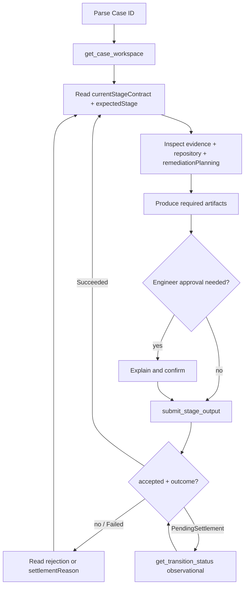

# Loop Capability Operation

Loop owns Case state, stage contracts, and allowed transitions. The agent investigates and submits **semantic actions** — it never mutates workflow state directly.

**Prerequisite:** `loop-engineering` MCP must be connected. Build and register per `docs/architecture/cursor-native-capability-prototype.md` §27 (`tools/loop-engineering-mcp`).

## Hard gate (violations invalidate the prototype)

When the engineer pastes a Case ID or says "Work on Loop CASE-…":

1. Call **`get_case_workspace` only** on the first turn.
2. Reply with the **First-touch summary** (template below). **End the turn.**
3. Do **not** call `submit_stage_output`, `request_capability_transition`, or `get_transition_status` on that first turn — even if the case looks simple, simulated, or fully diagnosable from evidence.
4. After the engineer explicitly confirms **one** action, submit **only that action**, then continue from the **settled** response (`outcome` / `currentStage`). Do **not** refresh via `get_case_workspace` as normal UX. Use observational `get_transition_status` only if `outcome` is `PendingSettlement`.
5. Never submit `AcceptAssignment` and `CompleteInvestigation` / `CompleteDiagnosis` / `CompleteRecommendation` / `CompleteRemediationPlan` in the same session turn or without separate confirmations per stage.
6. **`close_engineering_case`** is also gated — never call it on first-touch or without explicit confirmation (reason + outcomeType). Use when no stage action can close the Case (ops / manual disposition).

Pasting a Case ID is **not** consent to accept, investigate, complete, or submit a plan — it is a request to **load state and present options**.

## Standard operating model

Applies to Investigation, Diagnosis, Recommendation, Human Decision, Remediation Planning, Plan Review, Pipeline Remediation (InvestigationPlanning → Execution), and escalated Release Assurance (ReleaseReview / HumanDecision):

1. **Get Case workspace** — `get_case_workspace`.
2. **Read current stage contract** — objective, instructions, required outputs, available actions.
3. **Perform only the current stage objective** — do not skip ahead.
4. **Keep conversational work in Cursor** — Loop persists only submitted artifacts.
5. **Build durable output** — align with `requiredOutputArtifactTypes` before submission.
6. **Explain consequential transitions** — tell the engineer what the next Loop action will do.
7. **Get required human confirmation** — explicit go-ahead before every submit (see **Human confirmation** and **Structured option prompts**).
8. **Submit only an available semantic action** — from `currentStageContract.availableActions`.
9. **Consume settled context** — Control Plane returns `outcome` (`Succeeded` / `Failed` / `PendingSettlement`) with authoritative `currentStage` / `availableActions`. **Do not** call `get_case_workspace` as a normal follow-up after success.
10. **Continue from settled stage** — trust settled `currentStage` / `expectedStage` when present; use observational `get_transition_status` only for `PendingSettlement`.

## Operating rules

1. When given a Loop Case ID, call `get_case_workspace`.
2. Read `capability.currentStage`, `capability.expectedStage`, and `currentStageContract` before acting.
3. **Stop and summarize** — report the current stage, objective, and `availableActions` to the engineer before taking any action. When **two or more** actions apply, present them via **AskQuestion** when available, otherwise a short prose ask (see **Structured option prompts**).
4. **Never submit** `submit_stage_output` without **explicit engineer confirmation** (see **Human confirmation**). One action per confirmation — never chain stages in one turn.
5. If the stage is `AwaitingEngineerAcceptance`, only discuss **AcceptAssignment** or **RejectAssignment** until the engineer chooses.
6. If the stage is `Recommendation`, formulate an evidence-backed disposition recommendation from workspace investigation/diagnosis/evidence. Diagnosis explains *what/why*; Recommendation advises *what to do next*. Submit **CompleteRecommendation** only when complete and truthful — never auto-chain into a human disposition.
7. If the stage is `AwaitingHumanDecision`, present the active recommendation from `humanDecision` and disposition actions from `availableActions`. Submit **one** disposition only after explicit confirmation — never auto-select the recommended disposition even when confidence is high.
8. If the stage is `RemediationPlanning`, draft the plan collaboratively in Cursor; submit **CompleteRemediationPlan** only after a reviewable plan exists and the engineer confirms submission.
9. If the stage is `PlanReview`, treat it as a **human decision gate** — summarize the plan and present review actions; never choose ApprovePlan / RequestRevision / RejectPlan / CancelPlanning without explicit engineer confirmation.
10. Treat Loop evidence as production facts, not automatically as conclusions.
11. Use repository/internal tooling to satisfy the current stage objective.
11. Do not transition merely because work was attempted or a draft exists in chat.
12. Submit required stage output before requesting completion actions that require outputs.
13. Only use actions returned by `currentStageContract.availableActions`.
14. Honor `requiresHumanConfirmation` on each action from the stage contract — do not maintain a separate hard-coded confirmation list.
15. Use **`capability.expectedStage`** for submissions — never submit persisted workflow aliases such as `AwaitingPlanReview` or `HarnessExecution`.
16. If new evidence invalidates prior work, use a permitted backward transition.
17. Never invent Case state.
18. Never perform destructive actions outside governed Loop actions.
19. After settled success, continue from settled context — do **not** use refresh as normal UX; use observational `get_transition_status` only for `PendingSettlement`.
20. For execution stages, read `executionContext` — never reconstruct execution state from chat history or latest plan by timestamp.
21. Git commit/push is Cursor agent work — never invoke Loop MCP for Git operations.

## Human confirmation

Explicit engineer confirmation is required before **every** governed action submit.

### When a single path was proposed (N = 1)

Valid confirmations are clear directives such as:

- "yes, submit the plan" / "yes, complete investigation" / "approve the plan"
- "yes, approve execution" / "yes, approve the implementation" / "yes, complete execution"
- "accept" / "reject" (+ reason when required)
- a named disposition: "AcceptNoAction", "PlanCodeRemediation", "ApproveExecution", "ApproveImplementation", "CompleteExecution", "RequestRevision", …

**Not sufficient on their own:** "looks good", "sounds fine", thumbs-up, or general enthusiasm without naming the action.

### Medium bar — when N ≥ 2 options were offered (structured option prompts)

After you presented **two or more** choices (AskQuestion picker or prose list of `availableActions` + Other), confirmation is **stricter**:

**Sufficient (any one):**

- An **AskQuestion** selection of one listed option (including **Other**, when Other text states a clear next intent)
- Naming the action explicitly (capability `name` or unambiguous label), e.g. `AcceptAssignment`, `ApprovePlan`, `RequestRevision`, "reject the assignment"
- **Other** free-text that clearly maps to one allowed path or an explicit non-submit intent (pause, refresh only, gather more evidence)

**Not sufficient when N ≥ 2 — do not submit:**

- Bare "yes" / "ok" / "go ahead" / "lgtm" / "looks good" / "sounds fine" / "do it" / emoji / silence
- Affirming the *recommendation* without naming which action ("that sounds right", "I agree with the recommendation")
- Selecting multiple actions in one message

**On insufficient reply:** do **not** call `submit_stage_output`, `request_capability_transition`, `submit_stage_retry`, or `close_engineering_case`. Re-present the **same** options (AskQuestion if available, else the same prose list) and ask the engineer to pick **one** named option or Other. One short re-ask — do not drip new questions.

## Structured option prompts

Whenever this skill applies and the engineer must choose among **two or more** paths, prefer the **AskQuestion** tool (selectable options + **Other**) when it is available in the current session's tool catalog.

**Confirmation level for this section:** use the **Medium bar** under **Human confirmation** — vague affirmatives never unblock a multi-option gate.

**Availability:** `AskQuestion` is **not** present in every Cursor session (some catalogs only expose tools such as `CreateGoal` / `GenerateImage` / `UpdateGoal`). Before calling it, confirm it exists in the live tool list. If it is missing or the call fails because the tool is unavailable:

- Fall back immediately to a **short prose question** with the same choices (compact bullets or a single sentence).
- Do **not** search the filesystem or MCP folders for AskQuestion.
- Do **not** treat missing AskQuestion as a blocker — the Medium confirmation bar still applies (named action or clear Other text required).

When AskQuestion **is** available, do **not** list options only as prose bullets or `A / B / C` text.

**Always include (picker or prose):**

- One selectable option per **permitted** action from `currentStageContract.availableActions` (use the action `name` as the label; add a one-line consequence in the label when helpful)
- **Other** — free-text so the engineer can describe a different intent (e.g. partial plan revision, pause for evidence, custom next step)

**Use AskQuestion (or prose fallback) at these Loop gates (non-exhaustive):**

| Moment | Options source |
| ------ | ---------------- |
| After first `get_case_workspace` | All `availableActions` + Other |
| Before any `submit_stage_output` | The single proposed action vs cancel/wait — or full `availableActions` when the engineer asked "what can I do?" |
| `AwaitingHumanDecision` | Disposition actions from contract + Other |
| `PlanReview` | ApprovePlan / RequestRevision or RequestPlanRevision / RejectPlan / CancelPlanning or MarkNoRemediation (per contract) + Other |
| `AwaitingExecutionApproval` (Gate A) | ApproveExecution / CancelRemediation or PI revision/reject/cancel/defer (per contract) + Other |
| `Execution` pre–Gate B | ApproveImplementation / CancelRemediation / … (per contract) + Other |
| `Execution` post–Gate B | Proceed to commit/push / revise further / Other — before Git work |
| Before **CompleteExecution** | Submit CompleteExecution / hold / Other |
| After rejection or stage mismatch | Refresh + retry / different action from refreshed contract / Other |
| Stage-retry park (transient failure, post-delivery hold) | Retry / Replan via `submit_stage_retry` + Other — requires explicit confirmation; not a capability action |

### Stage retry (recovery, not capability actions)

When the workflow is **parked at a stage-retry gate** (status `AwaitingGuidance`, persisted stage such as `HarnessExecution`, `AwaitingExecutionApproval`, post-delivery parks), use MCP **`submit_stage_retry`** — not `submit_stage_output`.

- **`Retry`** — re-enter the park's primary stage (e.g. HarnessExecution → external execution attempt).
- **`Replan`** — jump to an earlier allowed target (Planning, Diagnosis, etc.) per park policy.
- Requires **explicit engineer confirmation** before calling (same bar as capability submits).
- After acceptance, continue from the **settled** response (`outcome` / `currentStage` / `availableActions`). Use `get_transition_status` only for `PendingSettlement`.

Mirror the summary in prose (first-touch template, gate explanations below). When AskQuestion is available, the **selection UI is the primary input**; when it is not, the prose ask is the gate.

Single-path updates with no real fork (e.g. "settled success — continuing at next stage") stay plain text — no AskQuestion.

When proposing **CompleteRemediationPlan**, present the full plan summary and ask explicitly:

> The next Loop action is **CompleteRemediationPlan**, which will persist this plan and move the Case to **PlanReview**. Do you want me to submit it?

When proposing **ApprovePlan**, explain:

> Approval crosses the planning boundary and moves the capability to **AwaitingExecutionApproval**. It does not itself execute the remediation.

When proposing **ApproveExecution** (Gate A), explain:

> This authorizes implementation of the approved remediation plan. It does **not** approve the resulting code.

When proposing **ApproveImplementation** (Gate B), explain:

> This approves the implementation you reviewed. It does **not** change the capability stage — from the settled response verify `implementationApproved = true` (or capabilityState / available next actions) before commit/push.

When proposing **CompleteExecution**, present the final execution summary and ask explicitly before submitting.

## Standard workflow



### 1. Discover

When Teams notifies you of a pending assignment or investigation stage, paste the Case ID (or short id `CASE-XXXXXXXX`) into chat and start here:

```
get_case_workspace({ caseId: "CASE-3FA85F64" })
```

From the response, note:

- `case` — title, repository, service, severity
- `capability` — `executionId`, `currentStage`, **`expectedStage`**, `capabilityVersion`, `status`
- `currentStageContract` — `objective`, `instructions`, `requiredOutputArtifactTypes`, `availableActions`
- `evidence` — production and engineering evidence (facts to ground work)
- `previousStageOutputs` — prior brief/diagnosis (required context for planning)
- `humanDecision` — active recommendation and recorded disposition (e.g. `PlanCodeRemediation`)
- `reinvestigation` — populated after `RequestMoreInvestigation`
- `remediationPlanning` — when in planning/review: `session`, `latestPlan`, `priorPlans`, `review`, `revisionContext`
- `executionContext` — when at execution gates: `approval`, `approvedPlan`, `executionApproved`, `implementationApproved`, `phase`, `attempt`, `implementationReview`, `result`, `delivery`
- `pipelineRemediation` — Pipeline Cases: evidence, latest/approved EngineeringBrief, freeze/delivery flags, pipeline failure status
- `assignment` — assigned engineer when relevant

Use `get_case_evidence` or `get_available_actions` only when you need a focused slice without re-fetching everything.

For Pipeline Remediation, prefer `pipelineRemediation.approvedEngineeringBrief` after ApprovePlan — never replace it with a newer mutable `latestEngineeringBrief` without revision/approval. Full reference: [references/pipeline-remediation.md](references/pipeline-remediation.md).

### 2. Work the stage objective

Align all work with `currentStageContract.objective` and `instructions`. Open the Case repository when code inspection is required.

Separate **observed facts** (from Loop evidence) from **hypotheses**. Cite evidence references in stage outputs.

**Diagnosis context during planning:** read `previousStageOutputs.latestDiagnosis` and evidence references. Do not duplicate diagnosis into the plan projection — reference it via `diagnosisReference` in the plan output.

**Human decision context:** read `humanDecision.recordedDisposition` (e.g. `PlanCodeRemediation`) to understand why remediation planning exists and what remediation type was selected.

### 3. Submit a governed action

Prefer `submit_stage_output`. The MCP resolves `expectedStage` from `capability.expectedStage` on the workspace; you supply the semantic action, optional `reason`, and required `output` fields.

**InvestigationBrief** (`CompleteInvestigation`):

```json
{
  "caseId": "CASE-3FA85F64",
  "action": "CompleteInvestigation",
  "output": {
    "investigationSummary": "Concise narrative: facts, systems involved, hypotheses with confidence.",
    "evidenceReferences": ["src/...", "trace:abc123", "commit:deadbeef"]
  }
}
```

**ProductionDiagnosis** (`CompleteDiagnosis`):

```json
{
  "caseId": "CASE-3FA85F64",
  "action": "CompleteDiagnosis",
  "output": {
    "diagnosis": "Most likely root cause grounded in investigation facts.",
    "candidateRemediation": "Proposed fix or mitigation path."
  }
}
```

**Recommendation** (`CompleteRecommendation` — Cursor-owned; advisory only):

```json
{
  "caseId": "CASE-3FA85F64",
  "action": "CompleteRecommendation",
  "output": {
    "recommendedDisposition": "CodeRemediation",
    "recommendationSummary": "Evidence-backed next-step advice for the engineer.",
    "recommendedAction": "Plan a code remediation for the diagnosed null guard gap.",
    "rationale": "Diagnosis ties the NRE to missing metadata handling.",
    "urgency": "High",
    "confidence": 0.82,
    "supportingEvidence": ["diagnosis:root-cause", "trace:abc"],
    "recommendationRisks": ["Adjacent alert filtering may regress"],
    "verificationBeforeAction": ["Reproduce with fixture payload"]
  }
}
```

Do **not** submit a human disposition from Recommendation. After accept settles, expect `AwaitingHumanDecision`.

**RemediationPlanning** (`CompleteRemediationPlan` — requires full plan output):

```json
{
  "caseId": "CASE-3FA85F64",
  "action": "CompleteRemediationPlan",
  "output": {
    "summary": "One-paragraph plan overview.",
    "diagnosisReference": "Diagnosis id or citation from workspace.",
    "proposedApproach": "How the fix will be implemented.",
    "proposedChanges": ["Change Handler.cs guard clause", "Add unit test"],
    "affectedComponents": ["src/Handler.cs"],
    "validationPlan": ["Run affected unit tests", "Verify in staging"],
    "risks": ["Low regression risk in adjacent handler"],
    "rollbackConsiderations": ["Revert commit if staging fails"],
    "evidenceReferences": ["trace:abc123", "src/Handler.cs:42"]
  }
}
```

Confirm every field in `currentStageContract.requiredOutputArtifactTypes` is populated before asking the engineer to approve submission. Remain in `RemediationPlanning` while drafting — chat drafts are not durable until submitted.

**PlanReview** (`ApprovePlan` — no outputs):

```json
{
  "caseId": "CASE-3FA85F64",
  "action": "ApprovePlan"
}
```

**PlanReview** (`RequestRevision` — requires `reason`):

```json
{
  "caseId": "CASE-3FA85F64",
  "action": "RequestRevision",
  "reason": "Add rollback steps for database migration and clarify staging validation."
}
```

**PlanReview** (`RejectPlan` — requires confirmation; explain outcome first):

```json
{
  "caseId": "CASE-3FA85F64",
  "action": "RejectPlan",
  "reason": "Plan scope is too risky for current incident window."
}
```

RejectPlan closes the planning session as **Rejected**. The Production Investigation Case **remains open** under current legacy-compatible behavior — it is not Case closure.

**PlanReview** (`CancelPlanning` — requires `reason`):

```json
{
  "caseId": "CASE-3FA85F64",
  "action": "CancelPlanning",
  "reason": "Mitigation applied externally; code remediation no longer needed."
}
```

CancelPlanning ends planning. The Case **remains open** under current PI behavior.

**Backward transition** (`ReturnToInvestigation` — requires `reason`):

```json
{
  "caseId": "CASE-3FA85F64",
  "action": "ReturnToInvestigation",
  "reason": "New evidence contradicts the investigation summary; re-investigation required."
}
```

**AwaitingEngineerAcceptance** / **AwaitingHumanDecision** — see examples in [references/production-investigation.md](references/production-investigation.md).

The MCP resolves the acting engineer from `assignment.engineerEmail` on the case workspace. That value is sent as both `requestedBy` and `X-Loop-Actor-Email`.

### 4. Handle responses

| Response | Meaning | Agent behavior |
| -------- | ------- | -------------- |
| `accepted: true`, `outcome: Succeeded` | Settled — authoritative stage applied | Continue from settled `currentStage` / `availableActions`. **No refresh.** |
| `accepted: true`, `outcome: Failed` | Signal delivered but settlement observed failure | Surface `settlementReason`; do not auto-retry |
| `accepted: true`, `outcome: PendingSettlement` | Bounded settle timed out | Observational `get_transition_status` with `submissionId` / `idempotencyKey` — **never re-submit** |
| `accepted: false`, `code: TransitionNotAllowed` | Action not valid now | Re-read `availableActions`; do not retry the same action |
| `accepted: false`, `code: StageMismatch` | Stale expected stage | Realign from workspace/`expectedStage` — "The Case moved while we were working." Do not guess a retry stage |
| `accepted: false`, `code: MissingRequiredOutputs` | Plan or stage output incomplete | List missing fields; remain in planning and complete the output |
| `accepted: false`, `code: MissingRequiredReason` | Reason required | Collect reason from engineer and retry |
| `accepted: false`, `code: CapabilityVersionMismatch` | Version drift | Re-read capability version from workspace/settled state |
| `accepted: false`, `code: PlanMismatch` | CompleteExecution plan binding failed | Rebuild `planReference` from `executionContext.approvedPlan` |
| `accepted: false`, `code: MissingRequiredOutputs` (mentions `PushResult.Pushed` / `pushResult.pushed`) | CompleteExecution before a successful push | Push the branch in Cursor, then resubmit with `pushed: true` and SHAs |
| `accepted: false`, `code: ImplementationApprovalMissing` | Gate B not recorded | Do not CompleteExecution — obtain ApproveImplementation first |
| `accepted: false`, `code: ExecutionApprovalMissing` | Gate A not recorded | Verify `executionApproved` from settled/workspace context |
| `accepted: false`, `code: SignalDeliveryFailed` | Temporal signal failed | Do not auto-retry — report to engineer |
| `conflict: true` | Duplicate idempotency key | Observational `get_transition_status` with the same key, or a new key for a new intent |

On duplicate submission where the server returns idempotent settled state, treat as success — do not automatically resubmit.

Never assume a transition succeeded without `accepted: true` and a non-pending `outcome` (or a later observational Succeeded). Never guess the next stage.

### 5. After transition

After `outcome: Succeeded`, summarize for the engineer from the **settled** response: new `currentStage`, objective/actions, and what happens next. **Do not** call `get_case_workspace` as a normal follow-up.

After **CompleteRemediationPlan**, expect `currentStage = PlanReview` and `expectedStage = PlanReview`.

After **ApprovePlan**, expect `AwaitingExecutionApproval` (execution does not begin in proto-012).

After **RequestRevision**, expect `currentStage = RemediationPlanning` with `revisionContext` and `priorPlans` populated.

## Remediation planning (Cursor-native)

### RemediationPlanning stage

When `capability.currentStage = RemediationPlanning`:

1. Inspect `previousStageOutputs.latestDiagnosis` and production evidence.
2. Inspect relevant repository code.
3. Read `remediationPlanning.priorPlans` and `remediationPlanning.latestPlan` if present.
4. If `remediationPlanning.revisionContext.isRevision` is true, **explicitly address** `revisionContext.requestedReason` — this is a revision cycle, not fresh planning.
5. Discuss and refine the plan with the engineer in Cursor conversation.
6. **Remain in RemediationPlanning** while the plan is still being drafted — chat output alone does not transition the Case.
7. Submit **CompleteRemediationPlan** only when a reviewable plan exists and all required outputs are present.
8. Summarize the proposed durable plan and ask for explicit confirmation before submitting.

Use durable history from `priorPlans` / `latestPlan` — do not reconstruct revision history from Cursor chat. A new chat must resume solely from `get_case_workspace`.

### Plan revision cycles

When returning from PlanReview via RequestRevision:

- Read `revisionContext.requestedReason`, `priorPlans`, and the previous `latestPlan`.
- Preserve valid parts of the prior plan; explain what changed in the revised proposal.
- Do not submit a materially identical plan without addressing the revision reason.

### PlanReview stage (human decision gate)

When `capability.currentStage = PlanReview`:

- Summarize `remediationPlanning.latestPlan` for the engineer.
- Compare against diagnosis; highlight risks and validation strategy.
- Point out prior revisions when `priorPlans` is non-empty.
- Present actions from `currentStageContract.availableActions`: **ApprovePlan**, **RequestRevision**, **RejectPlan**, **CancelPlanning**.
- **Do not choose** the disposition — wait for explicit engineer confirmation.
- The agent must not infer this gate from raw workflow status; `PlanReview` in the workspace means human review is required.

## Cursor-native execution (proto-013)

Execution is performed **in Cursor** — Loop MCP governs lifecycle transitions only. The agent does not invoke the Engineer Worker coding harness, Human Guidance, or Electron chat for execution.

### Authoritative workspace fields

Always read `executionContext` at execution stages:

| Field | Use |
| ----- | --- |
| `approval` | Gate A intent — plan/revision, repository, constraints, `baseCommitSha` |
| `approvedPlan` | **The** plan to implement — not `remediationPlanning.latestPlan` unless they match |
| `executionApproved` | Gate A passed (`ApproveExecution` recorded) |
| `implementationApproved` | Gate B passed (`ApproveImplementation` recorded) |
| `phase` | `AwaitingExecutionApproval` · `Implementation` · `ImplementationApproved` · `Completed` |
| `attempt` | Active execution attempt; `isProvisionalResult=true` means work in progress |
| `implementationReview` | Gate B record bound to `executionResultId` |
| `result` | Finalized execution outcome (null while provisional) |
| `delivery` | Push/delivery evidence after completion |

Verify coherence before acting:

```text
approval.planId/revision = approvedPlan.planId/revision = attempt.planId/revision (when attempt present)
```

If inconsistent — stop, re-read settled/workspace context, report mismatch; do not guess.

Honor `currentStageContract.availableActions[*].requiresHumanConfirmation` — the contract is authoritative.

### AwaitingExecutionApproval (Gate A)

When `capability.currentStage = AwaitingExecutionApproval`:

1. Read `executionContext.approval` and `executionContext.approvedPlan`.
2. Summarize what the engineer is authorizing: plan summary, proposed changes, validation, risks, repository/branch constraints.
3. Explain available actions from `currentStageContract.availableActions`.
4. For **ApproveExecution**, state clearly: *This authorizes implementation of the approved remediation plan. It does not approve the resulting code.*
5. Require explicit engineer confirmation naming the action — do **not** auto-submit.
6. After accepted Gate A action → continue from **settled** response immediately.

Expected after **ApproveExecution**: `currentStage` at or past Execution (may briefly show ReadyForExecution — collapse candidate), `executionApproved = true`, `phase = Implementation` when present — **settled response wins**.

### Execution — pre Gate B (`implementationApproved = false`)

When `capability.currentStage = Execution` and `executionContext.implementationApproved = false`:

1. Treat Cursor as the execution environment.
2. Implement **`executionContext.approvedPlan`** — not the latest plan from history.
3. Inspect repository; verify Git base/branch against `attempt.baseCommitSha` / approval constraints.
4. Run build/tests; inspect diff; compare against approved plan.
5. Present implementation review summary to the engineer: changes, changed files, validation performed/passed/failed, risks, deviations, current Git status.
6. **Do not** invoke `ApproveImplementation` until the engineer explicitly confirms Gate B.

**Do not invoke Loop transitions for:** file edits, test failures, debugging, engineer questions, minor corrections, diff review.

### Gate B — ApproveImplementation (same stage)

After explicit Gate B confirmation:

```json
{
  "caseId": "CASE-3FA85F64",
  "action": "ApproveImplementation"
}
```

Then continue from the **settled** response (same stage expected).

Expected durable state (stage unchanged):

```text
currentStage = Execution
implementationApproved = true
phase = ImplementationApproved
```

Do **not** interpret unchanged `currentStage` as failure — verify `implementationApproved`, `phase`, and `implementationReview` from settled/workspace context.

### Execution — post Gate B (`implementationApproved = true`)

When `implementationApproved = true` and `phase = ImplementationApproved`:

- You **must not ask for Gate B again** — even in a fresh Cursor chat; workspace is authoritative.
- Verify worktree still matches the approved implementation.
- **Commit and push in Cursor** (not via Loop MCP) subject to repository constraints.
- Do not force-push unless explicitly permitted; do not invent PR fields.

**Post-approval mutation governance gap:** If you make **material code changes after Gate B**, the prior approval may no longer represent the delivery. Compare current diff to the reviewed state; if material changes occurred, tell the engineer and require renewed **ApproveImplementation** before **CompleteExecution**. Loop currently has no dedicated “invalidate Gate B” action — document this gap; do not conceal it.

### CompleteExecution

Construct output from actual Git/validation evidence (camelCase JSON):

```json
{
  "caseId": "CASE-3FA85F64",
  "action": "CompleteExecution",
  "output": {
    "changeSummary": "Removed server-error simulator per approved plan.",
    "changedFiles": ["src/ServerErrorSimulationService.cs"],
    "validationPerformed": ["dotnet test Hubtel.CCI.Tests"],
    "validationPassed": ["dotnet test Hubtel.CCI.Tests"],
    "validationFailed": [],
    "branchName": "feature/remove-simulator",
    "baseCommitSha": "abc123…",
    "finalCommitSha": "def456…",
    "planReference": "{planIdWithoutDashes}:{revision}",
    "deviationsFromPlan": [],
    "evidenceReferences": ["97ca8aba-fd50-43f8-8e43-bed24ee24327"],
    "pushResult": {
      "pushed": true,
      "remote": "origin",
      "branch": "feature/remove-simulator",
      "commitSha": "def456…"
    }
  }
}
```

- `planReference` = `{planId:N}:{revision}` from **`executionContext.approvedPlan`**.
- `changedFiles` from actual Git diff — not from the plan text.
- **`pushResult.pushed` must be `true`.** Do **not** call `CompleteExecution` until `git push` has succeeded. Loop **rejects** `pushed: false` (`MissingRequiredOutputs`) so a failed push never becomes terminal `DeliveryIncomplete`.
- Include `branchName`, `baseCommitSha`, `finalCommitSha`, and matching `pushResult.branch` / `pushResult.commitSha` from the successful push.
- Optional PR fields on `pushResult` (`pullRequestId`, `pullRequestUrl`) are metadata only — they do **not** open post-delivery parks. Delivery is `PushCompleted` (no PR) or `Delivered` (PR present); both close at successful push.
- Non-empty `validationFailed` may persist `PartiallySucceeded` when push succeeds — explain before submitting.
- Material deviations → consider **RequestRevision** instead of **CompleteExecution**.

`CompleteExecution` has `requiresHumanConfirmation = true` — present final summary and obtain explicit confirmation. Do not auto-chain Gate B → commit → push → CompleteExecution without the necessary human confirmations at each gate.

After accepted **CompleteExecution** → continue from settled context. Expect **`RemediationDelivered`** / Case **Closed** (close-at-push). Do **not** expect `link-pull-request`, `PartiallyDelivered` → PR linkage, `AwaitingPullRequestOutcome`, `AwaitingDeploymentConfirmation`, or `AwaitingProductionVerification` for new Cursor-native PI. Those specialty gates are **legacy drain only** for in-flight parks; recover incomplete delivery with **stage-retry**, not link-PR or specialty delivery-retry.

### RequestRevision / RejectImplementation / CancelRemediation from Execution

When available in `currentStageContract.availableActions`:

- **RequestRevision** — plan materially wrong; requires `reason` and explicit confirmation; after accept settles → expect `RemediationPlanning`; stop execution work.
- **RejectImplementation** / **CancelRemediation** — consequential; require reason + confirmation; do not continue delivery after Case leaves Execution.

## No Human Guidance fallback

For Cursor-native remediation planning, **do not** invoke or instruct use of:

- Human Guidance / Electron chat
- `AwaitingRemediationGuidance`
- Legacy remediation chat coordination

If the agent has questions, ask directly in Cursor. Durable Case state always comes from `get_case_workspace`.

## Production Investigation prototype scope

Prototype external interaction is the **default** for new Production Investigation (CreatedBy may still be `CursorNativePrototype` as metadata only). Interactive agent stages:

| Stage | Completion / review actions | Required outputs |
| ----- | --------------------------- | ---------------- |
| `AwaitingEngineerAcceptance` | `AcceptAssignment` / `RejectAssignment` | none (`RejectAssignment` requires reason) |
| `InvestigationBrief` | `CompleteInvestigation` | `InvestigationSummary`, `EvidenceReferences` |
| `ProductionDiagnosis` | `CompleteDiagnosis` | `Diagnosis`, `CandidateRemediation` |
| `Recommendation` | `CompleteRecommendation` | recommendation artifact set (disposition, summary, action, rationale, urgency, confidence, evidence, risks, verification) |
| `AwaitingHumanDecision` | disposition actions | none (`Escalate` requires `output.confirmExternalHandoff`) |
| `RemediationPlanning` | `CompleteRemediationPlan` | full remediation plan artifact set (see contract) |
| `PlanReview` | `ApprovePlan`, `RequestRevision`, `RejectPlan`, `CancelPlanning` | none (`RequestRevision`, `CancelPlanning`, `RejectPlan` benefit from `reason`) |
| `AwaitingExecutionApproval` | `ApproveExecution`, `RequestRevision`, `Reject`, `Cancel`, `Defer` | none (`RequestRevision`, `Reject`, `Cancel`, `Defer` require `reason`) |
| `Execution` | `ApproveImplementation`, `CompleteExecution`, `RequestRevision`, `RejectImplementation`, `CancelRemediation` | `CompleteExecution` requires full execution artifact set |

Full PI stage reference: [references/production-investigation.md](references/production-investigation.md)

Full Release Assurance escalated-path reference: [references/release-assurance.md](references/release-assurance.md)

Full Pipeline Remediation Cursor-native reference: [references/pipeline-remediation.md](references/pipeline-remediation.md)

## Pipeline Remediation Cursor-native scope

Interactive agent stages (CapabilityExecution). Assignment Accept/Reject is **not** a CE stage, but is **projected onto** `EvidenceCollection` while `assignment.assignmentStatus=AwaitingAcceptance`:

| Stage / gate | Completion / review actions | Required outputs |
| ----- | --------------------------- | ---------------- |
| Assignment offer (Case `AwaitingAcceptance`, CE still `EvidenceCollection`) | `AcceptAssignment` / `RejectAssignment` | none (`RejectAssignment` requires reason) |
| `EvidenceCollection` (after accept; automatic) | none | platform evidence |
| `InvestigationPlanning` | `CompleteInvestigationPlanning` | EngineeringBrief fields (`IssueSummary`, `RootCauseHypothesis`, `RecommendedChanges`, `SuspectedAffectedFiles`, `RecommendedValidationCommands`, `ShouldProceedToExecution`) |
| `PlanReview` | `ApprovePlan`, `RequestPlanRevision`, `RejectPlan`, `MarkNoRemediation` | none (revision/reject/no-remediation require reason) |
| `AwaitingExecutionApproval` | `ApproveExecution`, `CancelRemediation` | none (`CancelRemediation` requires reason) |
| `Execution` | `ApproveImplementation`, `CompleteExecution`, `CancelRemediation` | `CompleteExecution` requires push-success delivery evidence |

After `ApproveImplementation`: commit/push allowed; material code changes require governed revision. Do not auto-chain Gate A → Gate B → CompleteExecution. Non-PR cases cannot authorize delivery — use `CancelRemediation` / `MarkNoRemediation` with `UnsupportedNonPrFailure`.

Execution approval and delivery use `pipelineRemediation` (+ workspace stage contract) — do not bypass with invented actions.

## What not to do

- Do not PATCH Case APIs, signal Temporal directly, or update database state.
- Do not call actions absent from `currentStageContract.availableActions`.
- Do not submit stage completions without required output fields.
- Do not treat chat history as durable Case evidence — Loop persists submitted artifacts.
- Do not push commits, open PRs, or run destructive repo operations unless the current governed stage explicitly authorizes it.
- Do not auto-complete simulated/validation cases — the engineer still confirms each governed action.
- Do not submit `expectedStage = AwaitingPlanReview` — use `PlanReview` via workspace `capability.expectedStage`.

## First-touch summary template (required before any submission)

After the initial `get_case_workspace`, respond with this and **stop** — no submit calls on the same turn:

```markdown
**Case:** CASE-XXXXXXXX — {title}
**Stage:** {capability.currentStage} (expected: {capability.expectedStage}, {capability.status})
**Objective:** {currentStageContract.objective}
**Available actions:** {comma-separated action names from currentStageContract}
**Assignment:** {assignment.engineerEmail} — {assignment.assignmentStatus}
**Recommendation / decision:** {humanDecision.activeRecommendation.summary or humanDecision.recordedDisposition when present, else "n/a"}
**Planning:** {remediationPlanning.session.status + latestPlan.revision when remediationPlanning present, else "n/a"}
**Execution:** {executionContext.phase + approved plan rev when executionContext present, else "n/a"}
**Pipeline:** {pipelineRemediation.pipelineFailureStatus + approved brief version + freeze/delivery flags when pipelineRemediation present, else "n/a"}

I have not submitted any Loop actions yet.

Prefer **AskQuestion** for each action in **Available actions** plus **Other** (free-text). If AskQuestion is not in this session's tool catalog, ask the same choices in short prose.

**Release Assurance `ReleaseReview`:** after the template above, also surface `releaseAssurance.deterministicAssessment` (outcome, summary, reasons) and `releaseAssurance.hostEvidence` (type/status/summary per item) before offering `CompleteReleaseReview`. See `references/release-assurance.md`. RA has no AcceptAssignment gate — assignment is select+auto-accept.

**Pipeline Remediation:** after the template above, also surface `pipelineRemediation.evidence` (failure + PR/branch), latest vs approved EngineeringBrief versions, and freeze/delivery flags before offering planning or execution actions. See `references/pipeline-remediation.md`. When `assignment.assignmentStatus` is `AwaitingAcceptance`, offer only `AcceptAssignment` / `RejectAssignment` from `availableActions` (projected onto EvidenceCollection — not a separate CE stage).
```

Wait for the engineer to pick **one** action (or Other) before calling `submit_stage_output` or any other mutating MCP tool. Apply the **Medium bar**: bare "yes" / "lgtm" / "looks good" is **not** enough when multiple actions were listed — re-ask until they name one option or Other.

## Engineer-facing summary template

After each accepted transition:

```markdown
**Case:** CASE-XXXXXXXX — {title}
**Stage:** {capability.currentStage} (expected: {capability.expectedStage})
**Action submitted:** {action}
**Next objective:** {objective from refreshed contract}
**Available actions:** {comma-separated action names}
```

## Trigger phrases

**`Work on Loop CASE-XXXXXXXX` is the standard entry point.** The hard gate always applies.

| Phrase | First turn behavior |
| ------ | ------------------- |
| `Work on Loop CASE-XXXX` | `get_case_workspace` → first-touch summary → **stop** |
| `Investigate Loop case …` / `What's the current stage for CASE-…?` | Load and report only |
| `Submit CompleteRemediationPlan for …` / `approve the plan` | Prior workspace load required; submit **only** after confirmation |

Saying "Work on Loop …" is **never** permission to accept, investigate, complete, submit a plan, or chain stages.
